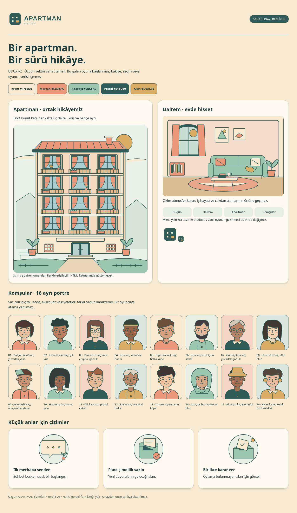

# UI/UX v2 — sanat temeli ve inceleme rehberi

Durum: **sanat onayı bekliyor**. Başlangıç main `c459a4c`. Varlıklar özgün, kodla çizilmiş düz vektör illüstrasyonlardır; profesyonel karakter sanatçısı onayı alınmış veya final oyun sanatı olarak kabul edilmiş değildir.

## Görsel kanıt

Aşağıdakiler SVG maketi veya hayalî ekran çıktısı değildir: Chromium'un izole HTML galerisinden aldığı gerçek tam sayfa PNG ekran görüntüleridir. Canlı oyun ekranı görüntüsü değildir.

- [1440 px — bütün varlıkların galerisi](previews/gallery-1440.png)
- [390 px — aynı galerinin mobil düzeni](previews/gallery-390.png)

## Sanat ilkeleri

- Petrol konturlar, yumuşak köşeler, düz renk bölgeleri; doku, ağır filtre, gradyan ve animasyon yok.
- Bina balkonları, çiçeklik, posta kutuları, giriş basamakları, bank, bahçe ve kedi mahalle sıcaklığı sağlar. Simetrik yapı 12 daireyi okunur tutar.
- Portreler aynı 220×240 ölçüde omuzdan yukarıdır. Saç silüeti, yüz hattı, ten, ifade, gözlük, şapka, başörtüsü, kulaklık, sakal ve kıyafet ayrışır. Numaralar yalnızca galeri katalog etiketidir; karakter kimliği değildir.
- Daire içi kanepe, çay, kitaplar, pencere ve kediyle atmosfer kurar. Özel eşya satın alma/dekorasyon sistemini ima eden düğme yoktur.
- Küçük boş durum görselleri 220×220; önerilen sunum 80–150 CSS px. Metnin veya gerçek durum bilgisinin yerine geçmez.

## Token ve erişilebilirlik sistemi

`src/styles/tokens.css` sadece `.art-v2` kapsamında opt-in kullanılır. Canlı uygulamaya import eklenmedi.

| Alan | İlke |
| --- | --- |
| Renk | Kesin beş renk korunur. Petrol birincil yüzeyde açık `#FFF9F0` metin; açık yüzeylerde `#203F3C` gövde ve `#4D6258` yardımcı metin. Mercan/altın/adaçayı üzerinde koyu yazı; petrol üzerinde koyu yazı kullanılmaz. |
| Koyu yüzey | Opt-in `[data-theme=dark]` için koyu yüzey/açık metin tokenları. İllüstrasyon renkleri ters çevrilmez. Sistem teması entegrasyonu bu PR'da yapılmaz. |
| Tipografi | 16 px gövde, 14 px yardımcı metin, 28–48 px duyarlı ana başlık. Yuvarlak sistem fontları; haricî indirme yok. Nihai font henüz onaylanmadı. |
| Boşluk | 4, 8, 12, 16, 24, 32 px ritmi. Sohbet alanında görsel payı düşük kalmalı. |
| Köşe | 12 px küçük yüzey, 24 px kart, hap biçimi yalnız kısa durum etiketi. |
| Gölge | 6 px düşük opaklıklı sabit taban gölgesi. Çok katmanlı blur/filtre yok. |
| İkon | Sonraki UI için mevcut bağımlılık eklemeden 24×24 viewBox, 2 px yuvarlak petrol çizgi kullanan tek bir yerel SVG seti önerilir. Görsel onaydan önce yeni ikon kütüphanesi eklenmedi. Emoji avatar yerine kullanılmaz. |
| Erişim | Bilgi yalnız renk ile verilmez. Sonraki cephe overlay'i gerçek HTML buton, klavye odağı, açık daire adı ve en az 44 px dokunma alanı gerektirir. SVG dekoratifse boş alt; anlamlıysa yerelleştirilmiş alt gerekir. |

## Dosya envanteri ve gerçek kullanımlar

Tüm görseller `public/art/v2/` altındadır. Galeri `tests/fixtures/art-v2/index.html` bütün 24 SVG'yi yerel `img`/favicon olarak kullanır. Üretim React bileşenlerinde kullanım **henüz yoktur**. Vite public dosyalarını kopyalar; tarayıcı kullanılmayan varlıkları kendiliğinden indirmez. Gelecekte URL'ler `${import.meta.env.BASE_URL}art/v2/...` ile kurulmalı; `/art/...` mutlak yolu GitHub Pages alt dizininde kullanılmamalı.

| Dosya | Ölçü | Planlanan yer / mevcut kullanım |
| --- | --- | --- |
| `logo.svg` | 430×104 | Yatay marka; galeri başlığı |
| `logo-mark.svg` | 96×104 | Tek marka simgesi; galeri boyut örneği |
| `favicon.svg` | 96×104 | Tarayıcı simgesi; yalnız galeri favicon'u |
| `apartment-facade.svg` | 1000×1100 | Apartman ekranı; galeri ana çizimi |
| `apartment-anchors.json` | 12 bölge | Gelecekteki HTML overlay koordinatları; bu PR'da işleme bağlanmaz |
| `avatars/portrait-01.svg` … `portrait-16.svg` | Her biri 220×240 | Portre koleksiyonu; galeride 16'sı da görünür |
| `avatars/manifest.json` | 16 açıklama | Yerel portre kataloğu; kullanıcı verisi/atama içermez |
| `apartment-interior.svg` | 900×600 | Dairem atmosferi; galeri |
| `empty-chat.svg` | 220×220 | Boş sohbet alanı önerisi; galeri |
| `empty-mail.svg` | 220×220 | Boş duyuru alanı önerisi; galeri |
| `empty-vote.svg` | 220×220 | Oylama olmayan alan önerisi; galeri |

Daire koordinatları SVG user-unit cinsindendir. Ölçek: container içinde SVG'nin gerçek çizim dikdörtgeni ölçülür; `preserveAspectRatio="xMidYMid meet"` boşlukları hesaba katılır. 1/2/3 alt konut sırası, 10/11/12 üst sıra; giriş hiçbir daire hitbox'ına dahil değildir. Ad ve numara SVG'de yoktur. Overlay eklenmesi bu sanat PR'ının dışındadır.

## Köken, performans ve yeniden üretim

Görseller bu proje için özgün SVG geometri koduyla çizildi. Başka bir oyundan, stok sitesinden veya marka kütüphanesinden resim kopyalanmadı. Raster/gömülü görsel, uzaktan font veya üçüncü taraf görsel lisans girdisi yoktur. Repository'nin genel lisansı değiştirilmez; üçüncü kişilere yeniden dağıtım lisansının seçimi proje sahibine aittir.

24 SVG toplam **43.379 bayt**, en büyük dosya 40 KB sınırının altında. Ek runtime bağımlılığı ve JS yükü yok. Tekrarlayan cephe öğeleri statik geometri; filtre, raster veya animasyon bulunmaz. İnceleme PNG'leri yaklaşık 800 KB'dir, `docs/` altında kalır ve Vite public çıktısına girmez.

- `python tools/generate-art-v2.py`: 23 temel SVG ve koordinat/katalog JSON'ları.
- `python tools/generate-art-v2-gallery.py`: yatay logo ve izole HTML galeri. İlk scriptin ardından çalıştırılır.
- `python tools/capture-art-v2.py`: ortamda zaten bulunan Python Playwright ve `/usr/bin/chromium` ile 390/1440 ekran çıktısı. Yeni proje bağımlılığı kurulmaz. Script yalnız loopback'te üç izinli asset yolunu sunar; dış ağ isteğinde başarısız olur. Browser önbelleği/oyuncu profili kullanılmaz.

Yerel `file://` gezintisi Chromium ortam politikası tarafından engellendi. Ekran görüntüleri bunun yerine standart loopback HTTP asset sunucusunda alındı; tarayıcı güvenlik politikası değiştirilmedi. Prod kodu, Supabase anahtarı veya Auth oturumu yüklenmedi. GitHub Actions screenshot workflow'u gerekmedi; mevcut workflow'lar değiştirilmedi.

## Testler ve kalite sınırları

- `npm test`: asset güvenliği/sayı/boyut/çeşitlilik, hitbox geometrisi ve galeri izolasyon testleri dahil.
- `npm run test:ui`, `npm run build` ve mevcut dört PostgreSQL süiti çalıştırıldı; sonuçlar PR açıklamasındadır. PostgreSQL yalnız mevcut localhost:55432 disposable altyapıdadır.
- Gerçek Chromium 390 ve 1440 px: bütün görsellerin yüklenmesi, yatay taşma yokluğu ve dış ağ yokluğu kontrol edildi. Sanat galerisi görsel olarak incelendi.
- Gerçek oyun ekranları, Auth/MFA, Realtime ve backend etkileşimleri bu PR'da tarayıcıdan yeniden sınanmadı; bunlar değiştirilmedi. 768 px, diğer telefonlar, koyu galeri ve ekran okuyucu kabulü tamamlanmış sayılmaz.
- Portreler stilize düz vektördür; final karakter estetiği, anatomi/ifade çeşitliliğinin yeterliliği ve küçük simgede logo algısı insan sanat onayı bekler. Yeni animasyon pozları, koyu sahne varyantı ve tam ekran oyun UI maketleri teslim kapsamında yoktur.
- İstenen temel 24 SVG'den eksik dosya yoktur. Sanat kalitesi kabulü açık kalır; kullanıcı onayı gelmeden merge yapılmaz.
