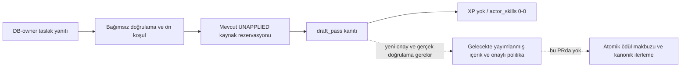

# A2-2a — Başlangıç öğrenmesi ve pasif XP kanıt temeli

Durum: **taslak / canlı aktivasyon yok**. Taban main: `54ccb3c42aef00de4b10e776b0bbdd15494721e2`.
Yeni migration: `20261128121953_a22a_passive_learning_foundation.sql` (Supabase CLI ile oluşturuldu).
Önceki 12 migration ve PR#24 [araştırması](A2_2_BALANCE_STUDY.md) değiştirilmez.

## Gerçekten kodlanan / açılmayan

| Teslim | Durum |
| --- | --- |
| Dört yetenek için üçer farklı/sıralı modül |12 Türkçe taslak; test fixture'ında, canlı veritabanına veya public asset'e yüklenmez |
| Seçim, sıralama ve eşleştirme değerlendirmesi | Saf TypeScript ve ondan bağımsız PostgreSQL kuralları; doğru/yanlış/geçersiz cevap testleri |
| Kanıt saklama ve kaynak bağı | Üç **boş**, private, API rollerine kapalı tablo; DB-owner-only taslak kayıt işlemi |
| İdempotency | Mevcut `xp_source_claims`; aktör+mantıksal içerikten sabit kaynak UUID'si, tek taslak kanıt |
| Gerçek XP, seviye güncelleme, onaylı XP politikası | **Yok**; `actor_skills` hâlâ0/0, botlar sabit |
| Oyuncu RPC'si/arayüzü, eğitim/kurs/üniversite açılışı | **Yok**; owner taslak işlemi public RPC olarak sunulmaz |
| Günlük/haftalık hak, kapasite, ön kayıt, gerçek ders oturumu | Yalnız aşağıdaki gelecek teknik sözleşmede; sayaç/cron/aktif mekanik uygulanmadı |

Yeni kod `src/domain/learning/index.ts` altında mevcut oyundan yalıtılmıştır. Mevcut uygulama bu modülü içe aktarmaz. Fixture `tests/fixtures/learning/starter-modules.json` altındadır; oyun tarafından okunmaz. Hiçbir üretim ödül miktarı, B eğrisi eşiği veya B+S örnek limiti kodlanmadı.

## Mevcut altyapı incelemesi

- `private.actors`: oyuncu `profiles`'a, bot ayrı `bot_profiles`/NPC konutuna bağlı. Aktörsüz hesaplar oyuna devam eder; bu işlem aktör oluşturmaz.
- `actor_skills`: tek kanonik seviye/XP deposu; TEXT yetenek anahtarı `skill_catalog` FK'sı. İkinci bakiye/XP gölge deposu yoktur.
- `skill_catalog`: dört `is_initial` kodu ve sonraki açık katalog genişlemeleri. Bu dilim yalnız dört başlangıç kodunun üçer modülünü kabul eder; katalog etkinliği eğitim aktivasyonu değildir.
- `player_skill_enrollments`: başlangıç dışı yetenekler için açık0/0 kayıt bağı; değiştirilmedi.
- `xp_source_claims`: **UNAPPLIED** kimlik rezervasyonu; `source_id` global tekil, aktör/alan/tür/gerekçe değişmez. Rezervasyon XP kredisi değildir.
- Son `a1_assert_actor`, oyuncuda dört başlangıç + açık kayıtlı ek yeteneklerin tamamını0/0 ister. Bot çalışan3, işletmeci4/İşletmecilik4, öğretim görevlisi alan6/Temel5/İleri3 ve öğreticilik alanında6 önceliği aynen korunur.
- Ayrıca `actor_skills` üzerindeki `a1_fixed_row` trigger'ı **UPDATE/DELETE'i engeller**. Sadece0/0 denetimini değiştirmek ilerleme sağlamaz; bunu kaldırmak da yeterli güvenlik tasarımı değildir.
- A1 oyuncu/NPC oluşturma, dünya bütçesi/onaylar, sabit satır ve deferred bütünlük trigger'ları değişmedi. Yeni kanıtlar hiçbir NPC oluşturma/yetenek işlemi yapmaz.

## 12 taslak modül

Bütün yollar seviye0'dan başlar.2./3. modülün tek öğrenme ön koşulu aynı aktörün önceki **mantıksal modüldeki taslak başarı kanıtıdır**; henüz sahip olmadığı yetenek seviyesi veya NPC kontenjanı istenmez. Bu taslakta üçü de oyuncunun0/0 değerlerini değiştirmeden sınanabilir.

| Kararlı kod | Türkçe ad / somut faaliyet | Başarı ölçütü |
| --- | --- | --- |
| `plumbing.starter.safe_valve` | Güvenli vanayı seç: sızıntı senaryosunda ilgili yerel vanayı ayırt et | Yangın hattı/pano yerine çalışır yerel vana |
| `plumbing.starter.diagnostic_order` | Tanı adımlarını sırala | İzole et→gözle→kontrollü test→kayıt |
| `plumbing.starter.material_match` | Sorun ile malzemeyi eşleştir | Aşınmış conta/gevşek bağlantı/kirli filtre için üç doğru eşleştirme |
| `business.starter.document_match` | Belgeyi işlemle eşleştir | Tahsilat/makbuz, satın alma/fatura, teslim/teslim belgesi |
| `business.starter.request_plan` | İhtiyacı plana dönüştür | İhtiyaç→malzeme→teklif→takvim |
| `business.starter.stock_choice` | Stok kararını gerekçeli seç | Talep3, stok1 örneğinde eksik2'yi seç; gerçek sipariş/OP yok |
| `basic_teaching.starter.observable_goal` | Gözlenebilir hedefi seç | Gösterilebilir davranış; ekranı açık tutmak başarı sayılmaz |
| `basic_teaching.starter.practice_sequence` | Öğrenme adımlarını sırala | Örnek→rehberli çalışma→kendi denemesi→geri bildirim |
| `basic_teaching.starter.feedback_match` | Geri bildirimi bulguyla eşleştir | Eksik adım, yanlış gerekçe ve doğru denemeye üç ayrı uygun yanıt |
| `advanced_teaching.starter.evidence_sequence` | Kanıtla değerlendirmeyi sırala | Ölçüt→çalışma kanıtı→karşılaştırma→sonraki adım |
| `advanced_teaching.starter.adaptation_match` | Çalışmayı kanıta göre uyarla | Kolaylık/eksik ön koşul/tutarsız sonuca uygun destek |
| `advanced_teaching.starter.fair_criterion` | Adil ölçütü seç | Aynı göreve ortak açık ölçüt; ün/giriş serisi yerine görev kanıtı |

Her fixture; ad, açıklama, amaç, somut görev, seçenekler, kararlı kod, sıra/ön koşul, başarı ölçütü ve ayrı Türkçe doğru/yanlış geri bildirimini içerir. Yanlış veya biçimsiz cevap başarı kaydı oluşturmaz. İki öğreticilik yolunun başlangıcı, özel öğretmen/öğretim görevlisi/profesör yeterliliğini **otomatik sağlamaz**. Önceden belirlenen yeterlilik eşikleri/verim sınırı değiştirilmez.

Bu ilk doğrulayıcılar doğru cevabı ölçer; insanın gerçekten öğrenmesini veya bot olmadığını kanıtlamaz. Fixture cevap anahtarları repository'de görünürdür; gizli anahtar değildir, anti-hile sırrı olarak kullanılamaz. Gerçek sunum için bağlama bağlı görev varyantı, taze oturum/deneme ve güvenilir değerlendirme tasarımı gerekir. Sadece `tamamlandı=true`, zamanın geçmesi veya kendi hesaplanan istemci puanı kabul edilmez.

## Pasif şema ve erişim

1. `private.learning_modules`: mantıksal içerik kimliği; `(skill_code,ordinal)` tekil, sıra1–3; aynı alanın önceki sıra FK/trigger ile zorunlu. Aynı ordinal'i başka kodla yeniden sunmak engellenir. Satırlar değişmez.
2. `private.learning_module_drafts`: `(module_code,version)` başına değişmez taslak metin/ölçüt/geri bildirim. `activation='draft_only'` sabit CHECK'tir; üretim/aktif durum yoktur. Cevap anahtarı API'ye açılmaz.
3. `private.learning_evidence_drafts`: mevcut `xp_source_claims.id` PK/FK'sına bağlı **taslak kanıt çocuğu**. `(actor_id,module_code)` tekil; aktör/alan/modül/sürüm FK'ları ve bağımsız trigger denetimleri. `status='draft_pass'`, sunucu saati, sunucuda hesaplanan SHA256 kanıt özeti ve geri bildirim saklanır. XP miktarı/seviye veya “ödendi” bayrağı yoktur.

Üç tablo RLS açık, policy olmadan ve `PUBLIC/anon/authenticated/service_role` üzerinde tüm tablo yetkileri kapalıdır. INSERT guard'ları DB-owner sınırını ayrıca doğrular; UPDATE/DELETE/TRUNCATE reddedilir. Yeni fonksiyonlar `private`, `SECURITY INVOKER`, boş `search_path` ve API execute yetkileri kaldırılmış biçimdedir. Süper Yönetici, diğer personel, cüzdan bakiyesi veya JWT `user_metadata` bu erişimi vermez. Hiçbir public kabuk, Auth trigger'ı veya cron çağrısı yoktur.

Migration **satır eklemez**:12 içerik, politika, aktör veya kanıt seed'i içermez. Disposable testler fixture'ları kendi geçici veritabanına yükler ve o veritabanını sonunda kaldırır. Mevcut12 migration tekrar çalıştırılmaz veya düzenlenmez.

## Taslak işlem sözleşmesi — gerçekten uygulanmış olan

`private.stage_learning_evidence_draft(actor,module,version,answer) → claim_id` yalnız `current_user='postgres'` ile çalışır. Bir oyuncu veya service_role endpoint'i değildir. Başarılı sonuç **taslak cevap doğrulaması** demektir, canlı tamamlanma veya XP yetkisi değildir. Bu PR kapsamında gerçek oyuncuya çağrılmaz.

1. DB-owner ve READ COMMITTED kontrol edilir. RR/Serializable bayat snapshot ile yeni kanıt kabul etmek yerine kapalı biçimde reddedilir.
2. Gerçek oyuncu aktörü ve mevcut Auth/profil/üyelik bulunur. Aktör otomatik oluşturulmaz; bot/olmayan aktör/ayrılmış sakin reddedilir.
3. Kilit sırası: building→üyelik KEY SHARE→mevcut yaptırım advisory anahtarı→actor FOR UPDATE. Aktif ban tekrar kontrol edilir. Mute yalnız sohbet kapsamındadır; öğrenme için yeni mute politikası getirilmez.
4. Mevcut `a1_assert_actor` çağrılır;0/0/fixed-bot koruması aşılmaz. Yeni kanıt aktarımı eski actor satırını veya guard_revision'ı bile değiştirmez.
5. Etkin başlangıç alanı, seçilen değişmez taslak sürümü, kanonik actor skill ve önceki modülün aynı aktöre ait kanıtı denetlenir.
6. PostgreSQL kendi sakladığı ölçütle ham yanıtı değerlendirir. İstemci başarısı/puanı/tarihi güvenilir kaynak değildir.
7. Aynı aktör+modül+sürüm+yanıt tekrarında ilk claim döner; ilk zaman/hash/yanıt değişmez. Farklı sürüm/yanıtla yeniden yazma reddedilir.
8. Yalnız mevcut `reserve_xp_source` kullanılır. UUID, sabit namespace + aktör UUID + **mantıksal modül kodunun** SHA256 özetinden deterministik türetilir; sürüm/cihaz/tarih/oturum içermez. UUID gizli veya bir yetki belirteci değildir. Global çakışma mevcut UNIQUE ve hedef kontrolleriyle kapalı reddedilir.
9. Kaynak türü `starter_learning`, değişmez gerekçe `starter module:<code>` olur. Yeni kanıt trigger'ı id/aktör/alan/kod ilişkisini tekrar doğrular; rastgele yeni kaynak UUID'si aynı amaçla kullanılabilir kanıt olamaz.
10. Kaynak rezervasyonu + taslak kanıt aynı atomik SQL işlemi içinde saklanır. Sonraki hata ikisini de geri alır. **XP/politika/günlük hak/kanonik seviye değişmez.**

`learning_evidence_drafts` ikinci kaynak defteri değildir: kendi kaynak UUID'si üretmez, mevcut claim olmadan var olamaz, kaynak PK'sına tekil bağlıdır. Genel owner-only `reserve_xp_source` başka amaçlarla metadata rezerve etmeye devam eder; bu bir ödül hakkı değildir. Rastgele/fazladan metadata rezervasyonları yeni öğrenme kanıtı olarak kabul edilmez. Eski rezervasyonlar ve eski kaynak türleri değiştirilmez.

Fonksiyonun doğrudan DML yolu da aynı kontrollerden geçer; owner'ın eklediği hash/geri bildirim/tarih güvenlik kanıtı sayılmaz, server trigger'ı yeniden üretir. Veritabanı sahibinin trigger'ları devre dışı bırakabilecek yönetim gücü tehdit modelinin dışındadır; “postgres'e karşı değişmezlik” iddiası yoktur.

## Neden XP'yi şimdi açmıyoruz?

Onaylı XP miktarı/ilerleme eğrisi/günlük hak yoktur.0/0 kontrolünü veya sabit satır trigger'ını gevşetmek bu boşluğu kapatmaz. Bu dilimde **ikisi de byte bazında korunur**; kanıtı doğru olan bir oyuncu bile XP veya seviye alamaz. Sayısal araştırma dosyaları üretim tarafından içe aktarılmaz.



Taslak kanıt gelecekte otomatik ödüllendirilemez. Üretim içeriğinin ayrı onayı, gerçek yetkili oturum/bağlam ve yeni doğrulama attestasyonu gerekir; aynı mantıksal içerik için **yeni ödül kaynak UUID'si yaratılarak tekrar kazanım** yapılamaz. Eski taslak, onay varmış gibi sessizce dönüştürülmemeli.

## Gelecek atomik XP sözleşmesi — henüz kodlanmadı

| Adım | Zorunlu sunucu denetimi |
| --- | --- |
| Kimlik | Doğrulanmış oturumdan `auth.uid()`→gerçek oyuncu aktörü; istemci actor/rol iddiası yetki değildir |
| Hesap/yaptırım | Hesap/üyelik/geçerli erişim; mevcut ban serileştirmesi; gerçek session/hesap iptalinin etkisi açık |
| Yetenek ve kanıt | Kanonik actor skill, yayımlanmış/onaylı içerik, geçerli ön koşul ve gerçek tamamlanma kanıtı |
| Kaynak | Mevcut claim ile aynı aktör/alan/içerik; tek completion/iş olayı; başka kaynağa/oyuncuya transfer yok |
| Politika | DB'den onay durumu ve sürümlü değişmez politika yüklenir; istemci XP miktarı/eşik/katsayı gönderemez |
| Haklar | Türkiye faaliyet günü/haftası, yetenek ve aktör geneli XP sayaçları, olay/hafta hakları atomik |
| Kanonik güncelleme | `actor_skills` seviye/XP ve tek kaynak ödül makbuzu aynı transaction içinde |
| Audit/tekrar | Claim PK'sına tekil immutable award receipt; politika/kanıt hash'i, server kazanım anı, önce/sonra değer ve gerekçe; replay ilk sonucu döndürür |

Gelecekte `xp_award_receipts` gibi claim'e bağlı bir **kredi/makbuz çocuğu** gerekli olabilir; bu yeni kaynak defteri veya ikinci XP bakiyesi değildir. Mevcut kaynak defterini çoğaltmak yerine claim_id tekilliği korunmalıdır. Bu PR'da receipt tablosu/fonksiyonu bile eklenmedi; onaysız miktar ve seviye kuralını üretime taşımıyoruz.

**A1'i ilerlemeye güvenli açma planı:**

- Aktör oluşturmanın ilk dört0/0 ve açık ek kayıt kuralları aynen sürmeli; `ensure_player_actor` mevcut ilerlemiş aktörü yeniden başlatmamalı.
- Oyuncu UPDATE engeli ve `a1_assert_actor` ancak aynı incelenmiş PR'da değiştirilmeli. Yeni doğrulama, kanonik XP/seviyeyi onaylı immutable makbuzlar ve politikaya bağlayarak uzlaştırmalı; API yazması hâlâ kapalı kalmalı.
- Bot branch'inin exact fixed-level/XP0 kuralları değişmemeli. NPC hiçbir award/usage yoluna alınmamalı.
- Özel GUC, `trusted=true`, JWT rol metadatası veya tarayıcı “sunucudan geldi” bayrağı guard bypass'ı olamaz.
- Politika aktivasyonu/iptali için ayrı ortak policy epoch kilidi, mevcut building/yaptırım/actor kilitleriyle tek sıra içinde tasarlanmalı. Politika yöneticisi ve oyuncu writer aynı sıraya uymalı. Sayısal politika iptali yarışları, ban, replay ve gece yarısı testleri olmadan açılmamalı.
- Aktör→kaynak→onaylı policy/usage/skill satırları için ortak kilit sırası ve whole-transaction retry kararı somutlaştırılmalı; aynı source ikinci receipt üretememeli. Bu PR'daki taslak işlem gelecekteki runtime award olarak kullanılmamalı.

## Zaman, günlük hak ve kapasiteye hazırlık

Şimdi saklanan `reserved_at/reserved_on`, yalnız **rezervasyon** zamanıdır; yeni `evaluated_at` yalnız taslak değerlendirme anıdır. İkisi de gelecek XP kazanım günü değildir. Gerçek server kazanım anı kilit beklemesinden sonra bir kez seçilmeli; `Europe/Istanbul` günü ve pazartesi başlangıçlı hafta bununla hesaplanmalı. İstemci saati/oturum değişimi takvimi değiştiremez.

Günlük/haftalık uygulama sayısı ile verilen XP aynı sayaç değildir. Gelecek politika sürümü; yetenek başına ve aktör genelinde sınırları, haftanın geçen günleriyle açılan hakkı, başarısız denemenin hakkı tüketip tüketmediğini ve XP tavanında kalan ödülün durumunu açıkça onaylamalı. B+S araştırmasındaki örnek sayılar **burada tanımlı değildir**. Eski günlere yeni maaş/XP dağıtımı, seviye kaybı veya giriş serisi ödülü getirilmez.

Kurs sunum kimliği ile mantıksal içerik kimliği ayrı kalmalı. Gelecek ön kayıt/kapasite tabloları, course offering başına yer hakkı ve öğretici bütçesini atomik yönetmeli; yeniden sunum modül kodunu ve XP kaynak kimliğini değiştirmemeli. Başlangıç taslakları NPC kontenjanı veya öğretici rolüne bağlı değildir. Ders/üniversite/işletme/ücretli iş fiilen açılmadı.

## Veri koruma, dağıtım ve geri dönüş

Migration öncesi disposable DB; kullanıcı/profil/üyelik/daire, cüzdan/maaş/aidat/kasa, seçim/oy/görev, sohbet, RBAC/MFA, aktör/NPC/konut/onay ve eski kaynak fixture'larıyla doldurulur. Sonra tüm eski tabloların **satır sayısı+JSON içerik hash'i**, eski fonksiyon tanımı/ACL, RLS/policy/trigger/publication ve cron kayıtları karşılaştırılır. Yeni şema rollback testi de vardır. Bu, canlı verinin incelendiği veya yedeğinin alındığı anlamına gelmez.

Sakin sonradan ayrılırsa yeni taslak kabulü durur; aktör/kanıt/kaynak korunur. Hesap silme, mevcut actor→profile RESTRICT zinciri nedeniyle engellenebilir; bu önceki A1 davranışıdır. Yeni otomatik silme, arşivleme veya veri onarımı yoktur. Aktörsüz sakin public oyunu kullanmaya devam eder.

Canlı uygulama bu görevin dışındadır. İleride yalnız ayrı onayla hedef proje/migration geçmişi kontrol edilmeli, boş şema migration'ı yedek ve kayıt özetleriyle değerlendirilmelidir.12 içerik fixture'ı otomatik canlı seed değildir. Gerçek içerik ve aktör/backfill rollout'u ayrı karardır.

Migration commit edilmeden rollback tam geri alınır. Uygulandıktan sonra API hâlâ kapalı olduğundan pasif şema bırakılarak operasyonel geri dönüş yapılabilir; kanıt/kaynak varsa otomatik DROP/DELETE/yeniden seed yapılmamalı. Düzeltme gerekirse onaylı ileri migration, veri koruma incelemesi ve aynı kaynak kimliği gerekir.

## Testler ve pratik sınırlar

```sh
npm test
npm run test:ui
npm run build
npm run test:sql
npm run test:v02
npm run test:rbac
npm run test:advanced
npm run test:a1
npm run test:a1-player
npm run test:a1-npc
npm run test:a2
npm run test:a2-npc
npm run test:learning
python3 -m unittest discover -s analysis/xp-balance -p 'test_*.py'
```

`test:learning`, yalnız sabit localhost55432 üzerindeki kendi `apartman_a22a_learning` disposable DB'sini oluşturur/siler; ortam değişkeniyle canlıya yönlendirilemez. Önceki `test:a2-npc` suite'i tarihsel ilk12 migration'ı sınadığı için yalnız dosya sayısı ön koşulu `>=12` olarak uyarlanmıştır; bütün eski assertion'lar korunur. Yeni suite ilk12 üzerine13. dosyayı ayrıca uygular.

Yeni 17 PostgreSQL grubu: migration rollback/veri+şema koruma, RLS/GRANT/Invoker/search_path,12 sıralı modül, TS/SQL grade eşleşmesi, başarısız kanıt,0/0 kalması, replay, versiyon, eşzamanlılık, kaynak aktarma, yarım işlem rollback, immutability, kazara EXECUTE grant savunması, RR reddi, ban/mute, eşzamanlı ban, ayrılma/actor-less ve eski kaynakların korunması. Alt kontroller bu17 başlık altında birlikte çalışır.

Yerelde 87 kaynak testi,70 önceki araştırma testi, statik UI, derleme ve eski 9 + yeni 1 PostgreSQL paketi başarılıdır. CI database job'una yalnız `npm run test:learning` eklendi; yayın koşulları veya frontend değişmez.

`npm run test:db` tam disposable Supabase Auth/Realtime stack'i ister. Bu ortamda `work/local-status.json` olmadığı için başlatılamadı; gerçek Auth HTTP, MFA töreni, Realtime ve çalışan pg_cron kabul testi yapılmadı. PostgreSQL testindeki Auth/JWT/MFA ve cron kayıtları sentetik stub'dır. Bu sınırları canlı kabul testi olarak sunmayın.

Supabase CLI2.75.0 ile `migration new` kullanıldı; yeni CLIv3 varsayılan config değişikliği incelendi, mevcut `config.toml` korunur. CLI bu sürümde advisors komutunu sağlamaz; canlı MCP/advisor çağrısı yapılmaz. Yerel sistem kataloglarında açık ACL/RLS/SECURITY INVOKER/search_path denetimi yeni entegrasyon testindedir.

## İlk 0–3 öğrenmesini açmak için sonraki onaylı dilim

1. Sayısal XP eşikleri/ödülleri ve günlük/haftalık haklar, XP kırpma/ertelemeyi de kapsayacak biçimde kesinleştirilsin.
2. Taslak içeriğin pedagojik/gerçek bağlamı, yayın onayı, deneme/oturum modeli ve üretim değerlendirme güvenliği incelensin. Doğru statik cevap “insan emek verdi” iddiası değildir.
3. Onaylı politika + immutable award receipt + kanonik XP/level uzlaştırması ve iki A1 guard'ının kontrollü dönüşümü **birlikte** ayrı PR'da test edilsin.
4. Auth kimliğini kendisi türeten checked RPC, atomik usage ve saat/gün/ban/replay yarış testleri ayrı incelensin. Bu PR'ın owner taslak fonksiyonuna oyuncu GRANT etmek yeterli değildir.
5. Ancak bundan sonra frontend ve sınırlı0–3 pilot erişimi, ayrı canlı migration/actor/backfill/içerik rollout onaylarıyla gündeme alınsın.

Bu PR taslaktır; gerçek XP, eğitim aktivasyonu, canlı migration, merge veya yayın yapılmaz.
