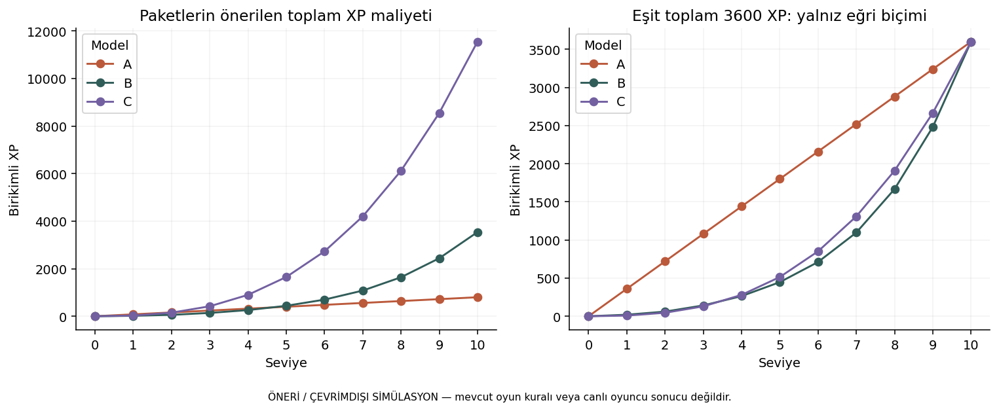
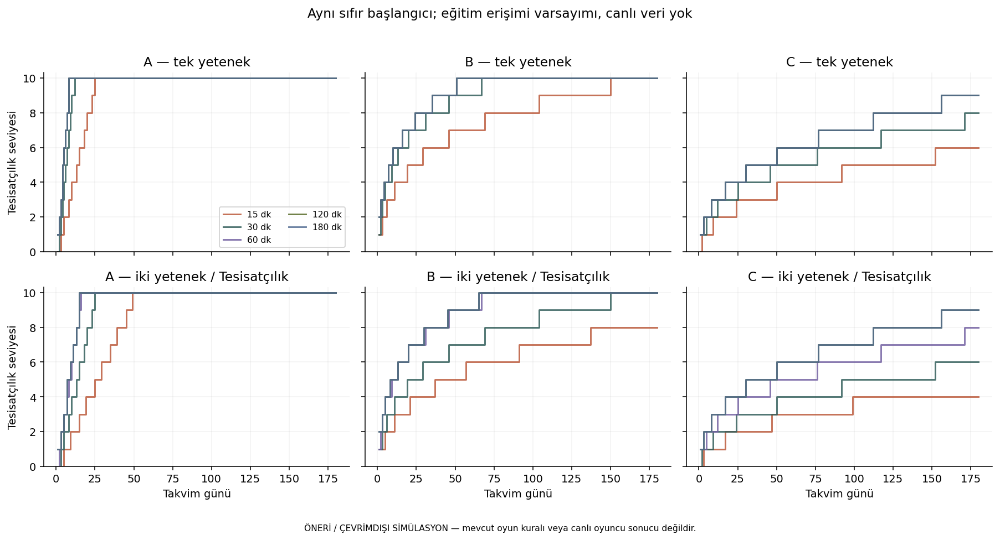

# A2-2 — XP dengesi, ilerleme eğrileri ve çevrimdışı simülasyon

**Durum: kullanıcı incelemesine sunulan araştırma; bütün yeni sayılar ÖNERİ / SİMÜLASYON VARSAYIMIDIR.**
Başlangıç: `4c2521d574b7d095a4a6c526d4fa7575078d9bd7` (PR #23 sonrası).
Hiçbir paket seçilmiş oyun kuralı değildir. Uygulamaya, SQL'e veya canlı dünyaya uygulanmamıştır.

## 1. Önce bütünleşik üç seçenek

| Öneri | A — Hızlı | B — Dengeli | C — Uzun vadeli |
| --- | --- | --- | --- |
| Eğri | Doğrusal: kademe başına 80 XP | Karma: 20/40/80/120/180/260/380/560/800/1100 | Artan: `30 × hedef_seviye²` |
| Toplam L10 | 800 XP | 3540 XP | 11550 XP |
| Başlangıç / kurs / kitap / uygulama / ücretli iş XP | 20 / 32 / 14 / 24 / 40 | 12 / 24 / 8 / 18 / 30 | 8 / 18 / 6 / 12 / 24 |
| Günlük sınır | Oyuncu genelinde 100 XP | Genel 110 + yetenek başına 70 XP | Yetenek başına 55 XP; genel sınır yok |
| Uzmanlık | Yalnız XP | L7: iki başarılı ileri uygulama; L9: 20 dk proje; L10: 10 dk yeterlilik | L7: dört uygulama; L8: 30 dk proje; L9: 15 dk yeterlilik; L10: 60 dk bitirme çalışması |
| Çoklu yetenek | Bir kaynak, tek ana yetenek | Hizmet yalnız mesleğe; ayrı doğrulanmış yönetim faaliyeti İşletmeciliğe | Hizmet toplam XP'sinin %80'i mesleğe, %20'si İşletmeciliğe |
| 30 dk, tek yetenek: L1 / L3 / L5 / L7 / L10 günü | 2 / 4 / 6 / 8 / 12 | 1 / 3 / 9 / 20 / 67 | 1 / 12 / 46 / 117 / 325 |
| 30 dk, iki yetenek: İşletmecilik 5 / ikisi de 10 | 13 / 25 gün | 19 / 150 gün | 92 / 650 gün |
| Güçlü yanı | Erken erişim, düşük giriş yükü | İlk ödül erken, orta hedefler ulaşılabilir | Uzmanlık uzun ömürlü, sabit botlar başlangıç desteği |
| Başlıca risk | Uzmanlık günler içinde tüketilir | Tavan sonrası çalışma cazibesini kaybedebilir | İşletme açma gecikir; tek alan ve çok alan oyuncusu ayrışır |

**İnceleme önerim B paketidir; uygulama onayı değildir.** A kısa pilot veya hızlı tur dünyasına, C uzun sezon ve geniş içerik havuzuna daha uygundur. Üçü de bağımsız geçerli seçeneklerdir; B'nin bütün parametrelerinin birlikte onaylanması gerekmez. C'nin çoklu ödül yolu mevcut tek-hedef kaynak sözleşmesiyle uygulanamaz; aşağıda ayrıca ele alınır.

## 2. Mevcut durum ve araştırmanın sınırı

- `actor_skills` tek kanonik seviye/XP tablosudur; bu çalışma onu okumaz veya yazmaz.
- Katalog, A1 oyuncu/NPC oluşturma ve A2 kaynak **rezervasyonu** vardır. XP dağıtımı, seviye yükseltme, başlangıç dersi, kurs, üniversite, kitap okuma, mesleki uygulama, işletme ve ücretli hizmet bu aşamada etkin değildir.
- `xp_source_claims.source_id` dünya genelinde tek UUID'dir; kaynak türü, aktör ve hedef yetenek bağını değiştirerek tekrar kullanılamaz. Mevcut kayıt **ödül miktarı veya gerçekleşmiş XP kredisi değildir**. `reserved_on` kazanım günü sayılamaz.
- Eski meslek, günlük ek iş ve maaşlar karakter XP'si üretmez. Başlangıç 300 OP, günlük maaş 100 OP, ek iş 25 OP ve başlangıç haftalık aidat 150 OP kuralları korunur. Bu araştırma OP geliri, fiyat, ücret veya kasa akışı hesaplamaz.
- Bot çalışan meslek 3; bot işletmeci meslek 4 ve İşletmecilik 4; bot öğretim görevlisi alan 6, Temel 5, İleri 3 olarak sabittir. Botlar ilerlemez ve XP almaz.
- Yetkiler, Auth/MFA, RLS, RPC, cron, frontend, eski migration'lar ve NPC nüfus planları değiştirilmez. Üretim uygulaması analiz dosyalarını içe aktarmaz.

Bu rapor yeni eğitim veya ödül sistemi tasarımının **sayısal adaylarını** inceler. Simülasyonun belleğindeki `Ledger`, bir sunucu ödül uygulaması, güvenlik kanıtı veya gerçek XP kaydı değildir.

## 3. Tekrar üretilebilir deney tasarımı

Kaynak: [`analysis/xp-balance/`](../../analysis/xp-balance/README.md).
Parametreler ayrı [`config.json`](../../analysis/xp-balance/config.json) dosyasında; hiçbir üretim ayarı bu dosyayı okumaz.

Tüm profiller dört alanda 0 seviye / 0 XP başlar. Günlük üst zaman bütçeleri 15, 30, 60, 120 ve 180 dakikadır; 240/360 dk duyarlılığı ayrıca vardır. Günlük bütçe harcanması zorunlu değildir; biten hedefte çalışma durur. Zaman, varsayımsal **doğrulanmış etkin emektir**; açık sekmede bekleme süresi değildir. Oyuncunun normal sohbet/gezinti süresi ayrıca modellenmez.

**Erişim varsayımları:** her alanda sıfırdan erişilebilir ücretsiz başlangıç dersi, yeterli sayıda farklı ders/kitap bölümü, gözetimli uygulama, gerekli seviyeye uygun eğitmen ve parçalı yeterlilik fırsatı hazır kabul edilir. Bu, gerçekte var olan bir eğitim hizmeti veya eğitmen kapasitesi iddiası değildir. İleri içerik/eğitmen arzı ayrıca tasarlanmalıdır; pilot alan 6 öğretim görevlisi tek başına alan 10'a eğitim verebilir diye varsayılmaz. Faaliyetlerin OP maliyeti, sıra bekleme ve pazar talebi temel karşılaştırmadan çıkarıldığı için sonuçlar iyimser erişim senaryosudur.

- Başlangıç dersi yetenek başına bir kez, 5 dk. Sonraki faaliyetler: kurs 15 dk (günde en çok 3), kitap 10 dk (2), uygulama 10 dk (3). Bu sayılar **öğrenci faaliyet tekrarı** varsayımıdır; öğretmenin öğrenci/ders kapasitesi formülü değildir.
- Temel senaryoda ücretli hizmet yoktur. Ayrı deneyde 15 dk hizmet (günde en çok 2) ancak varsayımsal Tesisatçılık 3 + İşletmecilik 5 sonrasında açılır. İşletmecilik 5 mevcut işletme açma tasarım şartıdır; **Tesisatçılık 3 burada yalnız karşılaştırma/erişim varsayımıdır**, kesin hizmet yeterliliği değildir. Her seçilen hizmet için gerçekçi talep ve doğrulanmış başarı hazır sayılır; talep yokken XP oluşması öngörülmez.
- İki alanlı ana strateji: 15 dk profil aktif günleri dönüşümlü tek alana ayırır; ≥30 dk profil süreyi iki alana 5 dk bloklarla böler, gün içi işlem sırasını dönüşümlü yapar. Ayrıca bütün profiller için dönüşümlü günler ve önce İşletmecilik 5 sonra Tesisatçılık 3 stratejisi karşılaştırılır. **30 dk eşiğinde strateji de değişir**; süre farkını tek neden saymayın.
- Faaliyet seçimi süre ve tekrar kısıtları içinde ham XP'yi artıran deterministik bir paketleme hesabıdır. Tavanı dikkate almadan seçer: kaybedilen potansiyel XP, aynı çalışmanın tavansız karşılığıdır. Oyuncuya tavana rağmen çalışmasını önermiyoruz; rasyonel oyuncu daha erken durabilir.
- Yeterlilikler ücretsiz, tek oyuncuyla erişilebilir ve 5 dk parçalara bölünebilir kabul edilir. İleri uygulama sayacı yalnız seviye 6'dan **sonraki başarılı** uygulamaları sayar. Yeterlilik etkinliğinin kendisi 0 XP'dir. XP üst sınırı L10 toplamıdır; yeterlilik yokken XP birikebilir ama seviye geçmez. Bu biriktirme politikası da onay bekler.
- Ana deneyde başarı %100'dür; her beşinci uygulama/hizmet/yeterlilik denemesinin başarısız olduğu duyarlılık ayrıca ölçülür. Başarısızlık süre tüketir, XP ve başarı kanıtı üretmez.
- Düzensiz profil pazartesi/çarşamba/cumartesi oynar. Ara veren profil 15–28. günler yoktur. Geç gelen profil 31. gün başlar. Uzun ara senaryosu ayrıca 31–90. günler (60 gün) yoktur. Gerçek kayıt tarihi yerine **2027-01-04 sentetik pazartesi** kullanılır; yayın takvimi değildir.
- Sonuçlar 7/14/30/60/90/180. günlerde kaydedilir. L10 gecikirse aynı varsayımlarla en çok **1460 güne** uzatılır; 180 sonrası kilometre taşları gözlenen 180 günlük sonuç değildir. CSV'de boş kilometre taşı ulaşılamayan/ufuk dışı hedefi gösterir.

## 4. Eğriler, formüller ve çalışma miktarı

Hedef seviye `l`, kademe maliyeti `Δ(l)`, toplam maliyet `T(l)=Σ(i=1..l) Δ(i)`; `T(0)=0`.

- A: `Δ(l)=80`, `T(l)=80l`. Başlangıç ve uzmanlık aynı maliyetli.
- C: `Δ(l)=30l²`, `T(l)=30l(l+1)(2l+1)/6`. Örnek `T(3)=30×14=420`, `T(10)=11550`.
- B: açık parametre dizisi `Δ=[20,40,80,120,180,260,380,560,800,1100]`. Örnek `T(5)=20+40+80+120+180=440`, `T(7)=1080`. İlk kademe 20, son kademe 1100 XP: motive edici giriş, 55 kat pahalı son adım.

[Sayısal ek](xp-balance-study/TABLES.md) her paket için **0–10 bütün kademe ve toplam tablolarını** içerir. Eğri biçimini paket ödülünden ayırmak için üçünün de toplamı ayrıca 3600 XP'ye ölçeklenmiştir. `3600×Δ/T(10)` oranları en büyük kalan yöntemiyle tamsayıya paylaştırılır; toplam değişmez. Bu eşit maliyetli tablolar alternatif oyun kuralı değildir, kontrollü karşılaştırmadır.



**30 dk/gün tek yetenek: takvim günü / birikimli doğrulanmış çalışma dakikası**

| Hedef | A | B | C |
| --- | --- | --- | --- |
| L1 | 2 / 40 | 1 / 20 | 1 / 30 |
| L3 | 4 / 100 | 3 / 80 | 12 / 360 |
| L5 | 6 / 170 | 9 / 250 | 46 / 1380 |
| L7 | 8 / 240 | 20 / 600 | 117 / 3510 |
| L10 | 12 / 340 | 67 / 2000 | 325 / 9735 |

Dakikalar hedefe ulaşana kadar **gerçekten simüle edilen faaliyetlerin** toplamıdır; takvim günü × günlük bütçe olmak zorunda değildir. Son faaliyet hedefi aşabilir. B'de 15 dk profil ilk gün başlangıç 12 + kitap 8 = 20 XP ile L1 olur. İkinci günden 15 dk kurs 24 XP varsayımıyla `20+5×24=140`: L3 altıncı gündür. Aynı profil yalnız kursa giderse L5 için `ceil((440−20)/24)+1=19` gün gerekir. İleri aşamada yeterlilikler süre kullandığından bu basit bölme tüm üst seviyeleri açıklamaz.

Bir saati olan oyuncu her zaman iki kat hızlı ilerlemez. Örneğin B'de tek alanda günlük 70 tavanı, 60 dk profili L10'a 51 günde; 30 dk profili 67 günde ulaştırır. Çalışma ise 3030 ve 2000 dk olur: daha uzun oturum tavan sonrası daha fazla ham faaliyet yapmıştır. Bu, zorunlu günlük görev önerisi değil, tavanın gereksiz tekrar üretebildiğinin ölçümüdür.

## 5. Faaliyet ödülü seçenekleri ve kötüye kullanım

Aşağıdaki örneklerin tamamı varsayımsaldır; karşılaştırma betiği **sabit başarılı-tamamlama ödülünü** kullanır. Süre ve kalite alternatifleri tablo içindeki tasarım karşılaştırmasıdır, çalıştırılmış denge paketleri değildir.

| Faaliyet | Sabit / B adayı | Doğrulanmış emek-süre alternatifi | Sonuç alternatifi | Tekrar ve kötüye kullanım sınırı |
| --- | --- | --- | --- | --- |
| Başlangıç | Bir kez 12 XP / 5 dk | Sunucu ders adımlarına en çok 5 dk eşdeğeri | Küçük yeterlilik kontrolü sonrası 12 | Aynı aktör/alan için tek tamamlanma; yeni cihazla tekrar yok |
| Kurs / üniversite | 24 XP / 15 dk bölüm | `min(doğrulanmış_dk,15)×1.6`, tamamlama şartıyla | 24 × başarı katsayısı | Farklı bölüm kimliği; aynı bölümden tekrar ödül yok; oturum/bölüm kotası |
| Kitap / bireysel | 8 XP / 10 dk bölüm | Doğrulanmış ilerleme için en çok 0.8 XP/dk | Bölüm soruları/uygulaması sonrası 8 | Sayfa yenileme, istemci zamanlayıcı veya aynı bölüm döngüsü ödül sayılmaz |
| Mesleki uygulama | Başarılı 18 XP / 10 dk | En çok 1.8 XP/dk doğrulanmış görev emeği | Başarıyla tamamlanan görev için 18; başarısız deneme 0 | Gerçek farklı görev, sonuç kanıtı, günlük sayı; bot tıklama döngüsü yok |
| Gerçek ücretli iş | Doğrulanmış tamamlanma 30 XP / 15 dk | İşin doğrulanmış aşamaları için en çok 2 XP/dk | Doğrulanmış kaliteye göre sınırlı aday ödül | Siparişin tek tamamlanması; iptal/iade/tekrar çağrı tekrar ödül üretmez |

Örnek süre alternatifi: 15 dakikalık kurs için tarayıcı 50 dakika bildirse de en fazla 24 XP adayıdır. Sunucuda ders ilerleme kanıtı yoksa **0**; yalnız zamanın geçmesi yetmez. Kalite alternatifi örneği `24×min(1,başarı_oranı)` ve yuvarlama politikası olabilir; katsayı/formül onaylanmadı. Sınavı tekrar deneyip kaliteyi artırmak aynı tamamlanma kaynağından yeni ödül yaratmamalıdır.

Sabit ödül açıklanabilir ve idempotency kolaydır, fakat çok kısa işleri çiftçilik için teşvik edebilir. Süre temelli ödül uzun işleri gözetir, fakat AFK ve gereksiz uzatma yaratabilir. Sonuç temelli ödül ustalığı ödüllendirir, fakat düşük seviyedekileri kilitleyebilir. B için başlangıçta sabit, doğrulanmış tamamlanma adayını; süreyi ödül çarpanı yerine uygunluk/üst maliyet kontrolü olarak değerlendirmeyi öneriyorum. Bu bir uygulama kararı değildir.

Ücretli iş XP'si ileride siparişin sunucu tarafından doğrulanmış bitişine bağlanmalı. Aynı tamamlanma kimliği, aktör ve hedef değiştirilemeden tek kaynak olur; işveren, işletme, meslek veya RPC adı değiştirilerek ikinci ödül çıkarılamaz. Kendi kendine sipariş, karşılıklı sahte hizmet ve kaynak havuzunu yeniden adlandırma ayrı kötüye kullanım kontrolleri gerektirir. Bu araştırma bunları uygulanmış saymaz.

## 6. Günlük limitler ve kazanım günü

B ödülleri sabit tutulduğunda, ikinci aktif günde 180 dk bütçe için:

| Alan sayısı | Sadece genel 110: verilen / ham XP | Sadece alan 70 | Genel 110 + alan 70 |
| --- | --- | --- | --- |
| Tek | 110 / 142 | 70 / 142 | 70 / 142 |
| Dört | 110 / 312 | 280 / 312 | 110 / 312 |

Dört alana eğitim erişimi de varsayımdır. Sadece alan sınırı farklı meslek/işletme/alanlara yayılan oyuncuya daha çok toplam XP sağlar; C'nin geniş uzmanlık portföyünü hızlandırır. Sadece genel sınır tek alanda uzmanlaşmayı hızlandırır ama çeşitli faaliyetleri aynı havuzda yarıştırır. B'nin birlikte sınırı tek alanda 70, toplamda 110 tutar; çeşitlenmeye 40 XP alan bırakır, çok alan çiftçiliğini sınırlar. İşlem sırası son bütçeyi etkileyebilir; simülasyonda sıra dönüşür. Gelecekte önizleme bunu anlaşılır göstermelidir.

**15 ve 180 dk karşılaştırması, tek alan / 180 gün:**

| Paket | 15 dk verilen / tavan kaybı | 180 dk verilen / tavan kaybı | Seviye farkı (15 / 180 dk) |
| --- | --- | --- | --- |
| A | 800 / 0 | 800 / 716 | 10 / 10 |
| B | 3540 / 0 | 3540 / 3612 | 10 / 10 |
| C | 3218 / 0 | 9900 / 8468 | 6 / 9 |

Tavan kaybı, aynı varsayımsal tamamlanmaların **doğrulanmış ham XP'si − tavan sonrası XP**'dir. L10 toplamını aşan son ödül ayrıca `max_lost_xp`, başarısız denemenin potansiyeli ayrıca `failed_potential_xp` olarak tutulur; üçü karıştırılmaz. L10 ve bütün kapılar tamamlanınca o alanda yeni XP faaliyeti durur; 180 gün boyunca anlamsız çiftçilik varsayılmaz.

- Gün anahtarı sunucunun gerçek kazanım zamanından `Europe/Istanbul` ile hesaplanmalı. Örnek UTC 20:59 = Türkiye 23:59, UTC 21:00 = ertesi gün 00:00. İstemci tarihi veya cihaz saat dilimi kullanılmaz.
- Bir kaynak önceki gün rezerve edilip ertesi gün doğrulanırsa **kazanım gününün** limitini tüketir. `reserved_on` yalnız rezervasyon bilgisidir. Bu görev mevcut SQL'e kazanım tarihi eklemez.
- Aynı kaynak ertesi gün yeniden çağrıldığında kalan ödül alınmaz. Araştırma, tavanla kesilen kaynağı tüketilmiş sayar; devreden XP veya bekletilmiş kredi yoktur. Tamamlama öncesi XP kaybı uyarısı / kaynak tüketme politikası ayrıca onay gerektirir.
- İleride aktörün genel günlük sayacı ve `(aktör,yetenek,gün)` sayacı ile kaynak tüketimi ve kanonik XP güncellemesi **aynı atomik işlemde**, sabit kilit sırasıyla korunmalı. Farklı faaliyet, meslek, işletme ve yeniden denemeler aynı sayaçlara uğramalı. Aynı anda gece yarısına gelen işlemlerde kazanım anı bir kez sunucuda seçilmeli.
- Rezervasyon günlerine yayılmış kaynaklar tek günde tamamlanınca genel limiti aşamamalı. İki kaynak aynı kaynağın kopyasıysa farklı UUID vermek çözüm değildir; gerçek tamamlanma kimliğinin de tekilliği gerekir.
- Boş günlerin limitleri bankalanmaz. Bu tavanlar yeni bir cron, ödül RPC'si veya günlük sayaç tablosu olarak bu PR'da uygulanmaz.

## 7. Uzmanlık: XP'den fazlası ne kadar gerekli?

| Seçenek | Güçlü yanı | Kilitlenme / tekrar riski | Erişilebilirlik tedbiri |
| --- | --- | --- | --- |
| Yalnız XP | Açık, düşük işletim maliyeti | Aynı düşük işi tekrarla uzmanlık | İleri içerik çeşitliliği gerekir |
| XP + başarılı uygulama | Meslek pratiği anlamlı | Az talep olan meslekte ilerleme durabilir | Ücretli müşteri şartı yerine ücretsiz gözetimli uygulama alternatifi |
| XP + sınav/proje | Uzmanlığı farklılaştırır | Sınav kaygısı, eğitmen kuyruğu, tek oturum yükü | Ücretsiz, parçalara bölünmüş, tekrar denenebilir yeterlilik |
| Bazı seviyelerde hibrit | Eşikler anlamlı, her seviye bürokrasi değil | Kanıt kayıtları ve XP biriktirme daha karmaşık | L7/L9/L10 ile sınırlı aday; ayrı solo erişim yolu |

A'da yalnız XP; B'de L7 iki ileri uygulama, L9 20 dk proje, L10 10 dk yeterlilik; C'de daha uzun koşullar vardır. Ek deneyde her seviyede uygulama ve her seviyede yeterlilik modelleri de sınanır. Bunlar pedagojik verim formülü değil, ek ilerleme koşulu adaylarıdır.

**Yalnız kapı politikasını değiştirme, B eğrisi/ödülü/limiti sabit:** 15 dk profilde XP-only L10 148 gün, uygulama-only 150, yeterlilik-only 153, B hibrit 150, C tarzı geniş kapılar 156 gündür. 60 dk profilde çoğu seçenek 51 gün: günlük XP tavanı zaten belirleyicidir. Kapıları eklemek tek başına uzun dönem içeriği üretmez.

Yeterlilik erişimi tümüyle kapatıldığında B 30 dk profil 180 günde 3540 XP biriktirir ama **L6'da kalır**. Bu açık kilitlenme kanıtıdır; üst seviye uygun içerik mevcut olmadan bu kapılar etkinleştirilmemeli. Aşırı XP bankalama, kapı açılınca çok seviye atlamayı da kolaylaştırabilir; bankalama limiti/önizleme politikası sonraki karardır.

**Önceden kesinleşmiş öğretmenlik şartları değişmez:**

| Görev | Temel Öğreticilik | İleri Öğreticilik | Öğretilen alan |
| --- | --- | --- | --- |
| Özel öğretmen | ≥5 | Şart yok | ≥5 |
| Üniversite öğretim görevlisi | ≥5 | ≥3 | ≥6 |
| Profesör | 10 | ≥5 | ≥6 |

Özel öğretmen profesörden yüksek eğitim verimine ulaşamaz. Verim ve öğrenci/ders kapasitesi formülü bu çalışmada seçilmez. Üç alanlı özel senaryoda (Temel 10 + İleri 5 + Tesisat 6) 30 dk profil A'da 25, B'de 90, C'de 447 günde eşiklere ulaşır. Bu **otomatik unvan/işe alım veya çalışan üniversite** değildir; varsayımsal eğitim erişiminde seviye eşiklerinin birlikte maliyetidir.

## 8. Tek faaliyet, çoklu yetenek

| Politika | Yarar | Bedel / güvenlik koşulu |
| --- | --- | --- |
| Tek ana alan | Açıklanabilir; mevcut tek-hedef kaynak sözleşmesine uygun aday | İşletme sahibinin yönetim öğrenmesi ayrı faaliyet ister |
| Toplamı koruyan %80 ana / %20 yan | İki rolü yansıtır; yeni toplam XP üretmez | Ana alan yavaşlar; eşzamanlı iki alan/genel limit ve kaynak modeli genişlemesi gerekir |
| İşletmecilik yalnız ayrı yönetim faaliyetinde | Sahip olmayı otomatik ustalık saymaz; meslek ve yönetim emeği ayrılır | Gerçek, doğrulanabilir yönetim faaliyeti henüz yoktur; aynı hizmeti yeniden adlandırmak olamaz |

B hizmeti tek alana bağlar; işletme yönetimi için ayrı gerçek tamamlanma varsa en çok 10 dk/18 XP (günde 2) analiz adayıdır. Bu faaliyetin içeriği henüz geliştirilmemiştir. Kitap/uygulama erişimi olan temel simülasyonda aynı süre/ödüldeki yönetim faaliyeti çoğu kez mevcut uygulamanın yerini alır; **bağımsız yönetim öğrenme avantajı üretmediği** sonuçlarda görünür. Bu yüzden yeni yönetim mekaniği bu sayılarla gerekçelendirilmiş sayılmaz.

Örnek B hizmeti 30 XP: tek alan `30/0`; korunan bölüşüm `24/6`; toplamı artıran `30/6` ise **%20 ek ham XP** yaratır. Sonuncusu yalnız enflasyon duyarlılığıdır, paket önerisi değildir. 15 dk çift alan profilinde 180 günde ana-only toplam 4620 XP, korunan bölüşüm 4626, eklemeli bölüşüm 4992'dir. Korunan toplamların zaman içinde biraz farklılaşması, değişen seviyeler/sonraki faaliyet seçimi ve tavan etkisidir; tek hizmetin bütçesi artmaz. Tesisat L10 sırasıyla 249/275/249 gündür.

**Mevcut `xp_source_claims` bir UUID'yi bir hedef yeteneğe bağlar.** Çoklu ödül mevcut imzaya sahte alt UUID'ler üreterek sığdırılmamalı. İleride kullanıcı çoklu ödülü seçerse tek değişmez tamamlanma ebeveyni, ona bağlı benzersiz `(kaynak,yetenek)` tahsisleri, toplam ödül bütçesi ve aynı atomik işlemde tüm sayaçlar gerekir. Ebeveyn actor/kaynak kimliği değiştirilemez; tekrar deneme bütün ödül vektörüne göre eşleşir. Bu **gelecek tasarım alternatifidir**; mevcut rezervasyon/SQL değiştirilmez. B'nin tek ana ödülünü onaylamak bu genişlemeyi gerektirmez.

## 9. Oyuncu profilleri ve 180 günlük sonuçlar

Aşağıdaki çizim ve [tam ek](xp-balance-study/TABLES.md), bütün 15/30/60/120/180 dk profillerini her üç modelde karşılaştırır. CSV'de 7/14/30/60/90/180 günlerin tamamı vardır.



**İki yeteneğin eşzamanlı gelişimi — Tesisat / İşletmecilik seviyesi, 30 dk/gün:**

| Paket | 7g | 14g | 30g | 60g | 90g | 180g |
| --- | --- | --- | --- | --- | --- | --- |
| A | 2/2 | 5/5 | 10/10 | 10/10 | 10/10 | 10/10 |
| B | 3/3 | 4/4 | 6/6 | 7/7 | 8/8 | 10/10 |
| C | 1/1 | 2/2 | 3/3 | 4/4 | 4/4 | 6/6 |

**B: iki ayrı yeteneğin maliyeti, aynı başlangıç:**

| dk/gün | Tek Tesisat L3 | Tek İşletmecilik L5 | Çift alanda İşletmecilik L5 | Her iki alanda L10 | Önce İşletmecilik5 sonra Tesisat3 |
| --- | --- | --- | --- | --- | --- |
| 15 | 6g | 19g | 38g | 300g | 25g |
| 30 | 3g | 9g | 19g | 150g | 12g |
| 60 | 2g | 7g | 9g | 67g | 9g |
| 120 | 2g | 7g | 8g | 65g | 9g |
| 180 | 2g | 7g | 8g | 65g | 9g |

Sıralı hedef çalışması iş açma eşiğini erkene çekebilir; genel tavan nedeniyle her zaman üstün değildir. B 30 dk dönüşümlü tam günler stratejisinde iki L10 134 gün, eşit günlük bölmede 150 gündür; B 60 dk için aynı değerler 102 ve 67 gündür. Tek “oynama süresi → seviye” formülüyle bütün davranışlar temsil edilemez. Strateji sonuçları `dual_alternate` ve `business_first` satırlarında bulunur.

**3 saat üstü:** `long_sessions.csv` 180/240/360 dk'yı karşılaştırır. B'de tek L10 her üçünde 51 gün, çift L10 65 gündür. C'de çift L10 211/210/210 gündür. Üst süreyi artırmak yeni ilerleme alanı açmıyor; oyuncu sosyal veya yönetim faaliyetlerine yönelebilir. Yeni tekrar eden zorunlu XP görevleriyle bu boşluğu doldurmayı önermiyorum.

**Düzensizlik ve dönüş:** B 30 dk çift alan profilinde 90. gün düzenli 8/8, 14 gün ara veren 8/8, 31. gün başlayan 7/7, haftada üç gün gelen 6/6'dır. Aynı seviye farklı XP'yi gizleyebilir; [CSV](xp-balance-study/snapshots.csv) tam XP içerir. 180. gün ilk üç profil 10/10'a ulaşır; haftada üç gün gelen 8/8 ve 3624 toplam XP'dedir. Geç başlayan oyuncunun yetişmesi **sonlu L10 tavanından** kaynaklanır; ücretsiz geçmiş XP dağıtılmaz. Düzenli oyuncu bitişe daha erken ulaşmış, önceki dönemde daha fazla erişim sağlamıştır.


İsteğe bağlı duyarlılık: ≥7 günlük aradan sonra yalnız bir kez 7 aktif gün boyunca doğrulanmış XP'ye %25 ek, aynı günlük sınırlar içinde. B'de 180 gün iki L10 çalışma miktarını 4470'ten 4440 dk'ya düşürür; dramatik telafi değildir. C'de dönüş senaryosunun 180g toplamı 5932 yerine 5988 olur. **Bu bonus paketlerin kuralı değildir.** Sürekli ara vererek avantaj, hesap yaşına göre ceza veya çevrimdışı biriken XP önermiyoruz. Geç başlayanlar için ücretsiz erişilebilir eğitim, içerik çeşitliliği ve eşit günlük tavanlar önce değerlendirilmelidir.

60 gün ara veren B 30 dk çift alan profili 30. günde 6/6 ve 1440 toplam XP iken 90. güne kadar aynı kalır; 180. günde 9/9 ve 5640 XP olur. Eski günlerin limitleri geri verilmez. Geçici seviye eşitliği, önceki erişim veya XP farkının kapanması anlamına gelmez.

İşletmecilik eğitimi erişilemez bırakıldığında bütün paketlerde İşletmecilik 0 kalır; iş açma hazırlığı ve ücretli hizmet XP'si oluşmaz. “19 gün” gibi sonuçlar mevcut oyunda ulaşılabilir hedef değil, gelecekteki varsayımsal erişimin maliyetidir.

## 10. Apartman ekonomisi, botlar ve motivasyon

- Bot çalışan 3'e karşı insanın Tesisat 3'e erişimi B'de tek odak 2–6 gündür; alan 6 öğretim görevlileri başlangıç referansı olarak kalır. İnsan daha sonra 7–10'a ilerleyebilir, bot sabit kalır. Seviye eşitliği aynı kapasite veya hizmet kalitesi demek değildir; insan/bot kapasite avantajı ve bot işletmesinin sabit genel 5 seviyesi burada yeniden formüle edilmez.
- İşletmecilik 5 bot işletmecinin 4 seviyesinin üstündedir. A'da 30 dk tek alan 6, B'de 9, C'de 46 gün; iki alana bölünürse 13/19/92 gün. A hızlı işletme arzı ve rekabet, C az sayıda erken işletmeci/uzun bot bağımlılığı riski taşır. B daha erken küçük apartman hizmeti döngüsü için uygun adaydır.
- Bunlar **erişim süresi etkileridir**, OP enflasyonu tahmini değildir. Sermaye, kaynak rezervasyonu, malzeme maliyeti, hizmet talebi, kadro, maaş ve bot müşteriler henüz bu modelde yoktur. İşletmecilik5 tek başına işletmenin kurulmuş/finanse edilmiş olduğunu göstermez.
- Eğitim apartman bakım ve onarımına açılan yol olmalı; sonsuz kitap tıklama döngüsü apartman oyununun yerini almamalı. Aynı içerik tekrarını ödüllendirmek yerine farklı görev/kanıt ve ücretli hizmette tek doğrulanmış tamamlanma gerekir.
- B'de 15 dk ilk seviye ilk gün, Tesisat3 altıncı gün: erken somut hedef vardır. 120–180 dk profillerin tavan sonrası kaybı büyüktür; günlük XP “yapılacaklar borcu” olarak sunulmamalı. Ödül dışında sosyal ilişki/ortak karar motivasyonu önemlidir; bu görevde yeni sosyal mekanik önerileri etkinleştirilmez.
- A'nın L10'a çok kısa süresi, yeni içerik eklenmeden tekrarı bitirir; reset/sonsuz prestij varsayılmaz. C'de 15 dk iki alan L10 1300 gün: erişilebilirlik ve geri dönme motivasyonu zayıflayabilir. B'de 300 gün daha makul olsa da altı aylık iki L10 hedefini kısa oynayan herkes karşılamaz; bu gerçek denge tercihi onay gerektirir.

## 11. Önerilen inceleme ve ayarlanabilir parametreler

B'yi **sınırlı çevrimdışı denge adayı** olarak tercih ediyorum: ilk seviye/mesleğe giriş erişilebilir, iki alan geliştirmenin bedeli görünür, günlük aşırı süre avantajı sınırlıdır. Dezavantajları tavan sonrası verimsizlik, çok alanlı kullanıcı için genel bütçe rekabeti ve henüz olmayan ileri eğitim/yeterlilik arzıdır. A veya C seçilirse de bu raporun karşılaştırma temeli korunabilir.

Parametreler daha sonra sürümlü ve sunucu kaynaklı yapılandırmaya uygun tutulmalı; bu PR üretim yapılandırması oluşturmaz:

- Kademe maliyetleri, faaliyet başına **sabit tamamlanma ödülü**, doğrulama uygunluğu ve günlük tekrar sayısı.
- Genel/alan tavanı, kazanım günü ve tavan nedeniyle kalan ödülün tüketilmesi/uyarısı.
- Üst seviye kanıtları, parçalı tamamlama, başarısızlıkta tekrar ve XP bankalama sınırı.
- Başlangıç ve ileri eğitim erişimi/maliyeti; eğitmen verimi/öğrenci kapasitesi hâlâ ayrı açık karardır.
- Tek kaynak/tek hedef ya da toplamı koruyan çoklu tahsis; gerçek yönetim faaliyeti tanımı.
- Sonlu L10 sonrası motivasyon; dönüş desteği yalnız ayrıca istenirse değerlendirilir.

`tuning.csv`, B ödüllerini ve **her iki tavanını birlikte** ±%25 değiştirir (tamsayı aşağı yuvarlama). 30 dk çift alan profilde ödül %75/%100/%125 iken İşletmecilik5 günü 25/19/15, Tesisat10 günü 200/150/121'dir; bu profilde tavan değişimi sonucu etkilemez. Yani her sorunu tavanla çözmek mümkün değildir. Daha uzun oturumlarda tavan etkisi vardır; tüm 27 kombinasyon dosyada bulunur.

**Kullanıcı onayı bekleyen kararlar:** paket/eğri, ödüller, günlük limit türü ve sayıları, 7–10 kapıları ve erişimi, XP bankalama/tavan kaybı, çoklu yetenek politikası, başlangıç eğitim yolunun gerçek erişimi. Öğretmenlik kesin eşikleri bu onay maddelerinden değildir; zaten korunur. Bir denge adayının seçilmesi canlı migration, kaynak rezervasyonu, NPC veya oyuncu oluşturma onayı değildir.

## 12. Teknik doğrulama, dosyalar ve sınırlamalar

- Betikler standart Python kütüphanesiyle çevrimdışı çalışır; parametre dosyası yalnız analizdir. Grafik için isteğe bağlı Matplotlib kullanılır; npm bağımlılığı eklenmez.
- 18 otomatik araştırma testi: maliyet toplamları, planın zaman/tekrar kısıtları, gün değişimi, kaynak tekrarının hedef değiştirememesi, tavan bileşimi, başarısız kanıt, üst XP sınırı, devretmeme, eksik eğitim/yeterlilik, parçalı proje, deterministik sonuç ve toplam korunumu.
- `study.py --check` CSV/JSON/Markdown'ı sıfırdan geçici dizinde üretip byte bazında karşılaştırır. PNG/SVG yeniden çizilebilir; Matplotlib/font sürümleri görüntü byte'larını etkileyebilir. Grafikler gerçek Matplotlib çıktısıdır, oyun ekran görüntüsü değildir.
- [`TABLES.md`](xp-balance-study/TABLES.md): insan tarafından okunur sayısal ek. `curves.csv`, `snapshots.csv`, `milestones.csv`, `daily.csv`, `cap_comparison.csv`, `sensitivity.csv`, `tuning.csv`, `long_sessions.csv`: ayrıntılı veri. `summary.json`: özet; `manifest.json`: parametre SHA256, başlangıç commit'i ve senaryo tanımları. Üç grafik PNG ve SVG olarak saklanır.
- Yerel doğrulama (28 Kasım 2026): araştırma 18/18, `study.py --check` birebir tekrar üretim, `npm test` 81/81, `npm run test:ui` ve `npm run build` başarılıdır. Bunlar uygulama regresyon kontrolleridir; araştırma testlerinin yerini almaz. PR'ın mevcut CI'ı ayrıca disposable PostgreSQL paketlerini çalıştırır; bu çalışma veritabanı test verisi oluşturmak için canlı projeye bağlanmaz.
- Simülasyon bir davranış tahmini veya güvenli ödül servisi değildir. Sosyal süre, OP bütçesi, pazar talebi, eğitmen kapasitesi, makro ekonomi ve gerçek oyuncu varyansı modellenmedi. Başarılı sentetik tamamlanmalar gerçek Auth/MFA/Realtime veya canlı eğitim kabul testi değildir.
- Güvenli geri alma: yalnız eklenen `analysis/xp-balance` ve bu rapor/sonuç dizinini geri al. Üretim kodu, eski doküman, şema veya veri geri alma işlemi gerekmez.

### Tekrar üretme

```sh
python3 -m unittest discover -s analysis/xp-balance -p 'test_*.py' -v
python3 analysis/xp-balance/study.py --check
# Grafikler isteğe bağlı; ortamda Matplotlib varsa:
MPLCONFIGDIR=/tmp/apartman-xp-mpl python3 analysis/xp-balance/study.py --figures
# Parametre deneyi repo sonuçlarını ezmeden ayrı dizine:
python3 analysis/xp-balance/study.py --config /tmp/xp-candidate.json --out /tmp/xp-candidate-results
```

Bu PR taslaktır. Birleştirme, yayın, üretim geliştirmesi veya canlı XP işlemi yapılmaz; denge ve tasarım kabulü kullanıcıya aittir.
