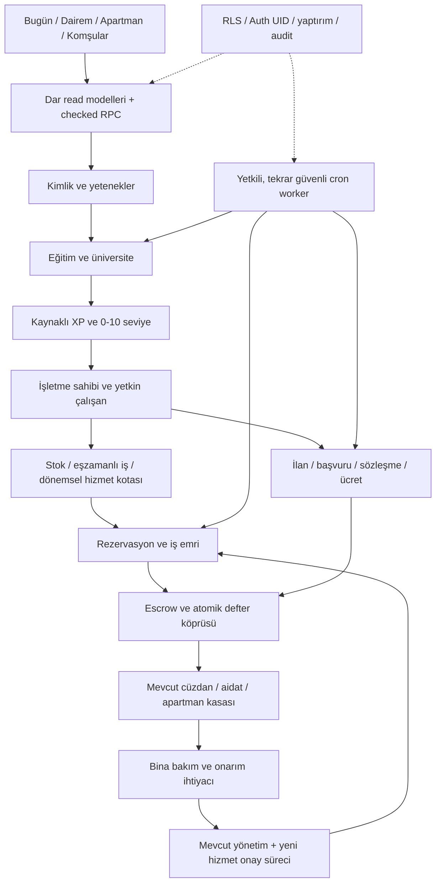
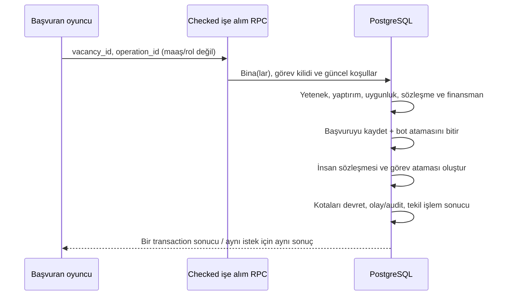

# Teknik mimari ve geliştirme şartnamesi — taslak

Bu belgedeki **Kural** maddeleri kullanıcı gereksinimidir; diğer mimari/formül/adlandırmalar **onay bekleyen öneridir**. Çalıştırılabilir SQL, uygulanmış şema veya yeni çalışan özellik değildir. Başlangıç envanteri [burada](CURRENT_SYSTEM_INVENTORY.md), açık kararlar/PR sırası [burada](DECISIONS_AND_DELIVERY.md).

## 1. Sınırlar ve modüller

Mevcut React/TypeScript/Vite + Supabase PostgreSQL/Auth/Realtime/Cron korunur. Ek Node sunucusu, ücretli kuyruk, harici AI bot servisi veya yeni proje yoktur. Botlar veriyle tanımlanmış kalıcı oyun aktörleridir; LLM sohbet kişileri değildir.

UI yalnız izin verilen alanları alır. İstek, oyuncunun kimliğini `auth.uid()` üzerinden bulur; istemciden fiyat, sahiplik, seviye, bot türü, maaş grubu veya rol kabul etmez. Modüller React'te ayrı tip/API/bileşenlere ayrılır; oyun sonucu PostgreSQL transaction'ında üretilir. RPC adları bu belgede **önerilen yeni sözleşmelerdir**, mevcut 27 RPC değiştirilmiş sayılmaz.

## 2. Aktör, konut ve yetenek modeli

**Kurallar:** Yetenek 0–10; oyuncular eğitim, üniversite ve mesleki uygulamayla gelişir. Botların kimliği, profili, mesleği, konutu kalıcı; yetenekleri sabittir. İnsan ve botlar farklı apartmanlarda yaşar.

Öneri: `actors` türü `player|bot`; player için benzersiz `profile_id → public.profiles`, bot için bu alan NULL ve ayrı bot profili. Oyuncunun mevcut profil/üyelik/daire/wallet ID'leri değiştirilmez. Bot için Auth hesabı, `profiles` veya `memberships` kaydı açılmaz: aksi hâlde Auth trigger'ı/başlangıç parası/nüfus/oy/aidat tetiklenebilir.

Bot konutları `npc_buildings` + `npc_homes` kataloğundadır; ayrı bina/daire envanteridir, oyuncu davetiyesi/daire atama yoluna girmez. Tek botun tek kalıcı konutu vardır. İş atamaları bu konutu veya mesleği değiştirmez. Oyuncu/bot sakin sayıları UI'da ve bina giderlerinde birleştirilmez. Bot evlerine gerçek oyuncu taşınamaz; botlar insan seçimlerine oy vermez.

İlk skill kataloğu Tesisatçılık, İşletmecilik, Temel Öğreticilik ve İleri Öğreticilik alanlarını ayırır; ilk kurs Tesisatçılık olsa da İşletmecilik ayrı yetenektir. İşletmecilik 5'e erişim için aynı eğitim altyapısında onaylı bir kurs/uygulama yolu B2'den önce açılmalı veya başlangıç dağılımında açıkça onaylanmalıdır; test fixture'ında 5 vermek gerçek oyuncu gelişim yolunun yerine geçmez.

`actor_skills` içinde her `(actor,skill)` bir satır; player için server XP defterinden türetilen seviye, bot için katalogdan sabit seviye. Seviye tamsayı 0–10; sonraki seviyeye ilerleme için ayrı integer XP önerilir. Eşik eğrisi ve başlangıç puanları açık karardır. `technical` legacy işi otomatik Tesisatçılık seviyesi sayılmaz.

XP her zaman tamamlanmış ve doğrulanmış eğitim/iş kaynağına bağlıdır; `(actor,skill,source_type,source_id)` unique. Başarısız/iptal/tekrarlanmış iş ikinci XP üretmez. Botlara XP yazımı sunucuda reddedilir. Günlük kazanım limiti, aynı işi döndürerek gelişim ve kendi işletmesinde kendine fatura kesme exploit'i engellenir. 7–10 gelişim yolu bot eğitmenin alan 6 sınırı yüzünden ayrıca tanımlanmalıdır; otomatik olarak herkese açılmaz.

### Bot sabitleri ve özel öğretici kuralı

| Bot görevi | Kural | Uygulama önerisi |
| --- | --- | --- |
| İşletmeci | İlgili gerekli yetenekler 4 | Oyuncu açılışındaki İşletmecilik ≥5 şartına **yalnız sistemce oluşturulmuş bot işletmesi** istisnası; client `bot=true` istisnası değil |
| Olağan çalışan | Mesleki yetenek 3 | İşletme/görev atamasına rağmen aynı NPC'nin profili ve seviyeleri değişmez |
| Üniversite alan öğreticisi | Alan 6, Temel Öğreticilik 5, İleri Öğreticilik 3 | Üniversite öğreticisi genel bot çalışan 3 standardının özel durumudur |
| Temel Öğreticilik öğreten bot | Öğrettiği alan için 6 zorunlu | Sabit Temel=6, İleri=3; Temel'i hem 5 hem 6 kaydetme |
| İleri Öğreticilik öğreten bot | Öğrettiği alan için 6 zorunlu | Sabit İleri=6, Temel=5; İleri'yi hem 3 hem 6 kaydetme |
| Bot işletmesi | Genel seviye sabit 5 | Hizmet kalitesi veya işleticinin İşletmecilik seviyesi 5 varsayılmaz |

Son iki satırdaki sabit profil oluşturma yöntemi, kullanıcının “öğretilen alan 6” önceliğinin mimari yorumudur; onaylanmalıdır. Bir NPC'nin farklı işletmede çalışması ona farklı yetenek değerleri vermez. Çelişen işletmeci/öğretici sabitleri tek NPC'ye yüklenmez; farklı kalıcı NPC'ler kullanılır. Bot profili rolleri ve override önceliği test fixture'ıyla sabitlenmeden seed/provisioning yapılmaz.

## 3. Eğitim, üniversite ve mesleki uygulama

Küçük ilk dikey dilim: Tesisatçılık + Temel/İleri Öğreticilik katalogları, bir alan kursu ve öğretici yeterlilik okuması. Gerçek üniversite kurumu bir bot işletme türü ve eğitmen ataması kullanır; prototipte tam işletme yönetimini taklit eden butonlar yoktur. Owner/staff olarak kurs yayınlama sonraki işletme dilimine kalabilir; ilk katalog sistemce yönetilir.

Önerilen akış: `available → enrolled/reserved → in_progress → completed | cancelled | expired`. Eğitim koltuğu, eğitmen hizmet kotası ve gerekiyorsa ücret aynı başvuruda rezervasyona alınır. İlerleme, süre ve görev tamamlama server saatinde doğrulanır. Kurs tamamlanmadan seviye yazılmaz; eğitmen seviyesi ve geçerli müfredat sürümü snapshot'lanır. Eğitmen yoksa/uygunsuzsa kurs satılamaz.

Öğreticilik, öğretilen alandan ayrıdır. Öneri olarak alan seviyesi öğrenci hedefini karşılamalı; Temel/İleri Öğreticilik hangi seviyeye kadar eğitim verilebileceğini ve eğitim verimini sınırlamalıdır. Katsayılar, eğitmen olma eşiği, üniversiteye giriş/mezuniyet/sertifika ve oyuncu öğreticinin geliri **kararlaştırılmamıştır**. İlk prototipin kazanım üst sınırı eğitmenin alanını aşmaz; 7–10 gelişim yolu açılmadan o seviyelere eğitim ürünü gösterilmez.

Mesleki uygulama XP'si gerçek tamamlanmış işten gelir; eğitim XP'si ayrı kaynak türüdür ama ortak günlük skill kazanım sınırını paylaşması önerilir. Eğitim ve çalışma için çakışan zaman/aktif iş kontrolü gerekir; botun işletmeler arası esnekliği gerçek oyuncunun sınırsız eşzamanlı görev hakkı olduğu anlamına gelmez.

## 4. İşletmeler: seviye, kalite ve kapasite

**Kural:** Oyuncu İşletmecilik ≥5 ile işletme açar. Sahip yeterliyse çalışabilir. Genel Seviye ve Hizmet Kalitesi ayrıdır. Mesleki yetenek hizmet kalitesini İşletmecilikten daha çok etkiler. Bakım, mevki, donanım, çalışan yetkinliği hesaba katılır.

İşletme açılması sunucuda skill/kayıt türü/kuruluş koşullarıyla doğrulanır. Kuruluş ücreti/sermayesi/lisansı ve bir oyuncunun işletme sayısı henüz belirli değildir; 300 OP tekrar verilmez, business hesabı sıfırdan başlar. Sahip çalışıyorsa aynı iş tanımı ve yetkinlik kontrolüne tabi aktif görev ataması olur; yalnız sahip olmak hizmet üretmez.

**Önerilen kalite ayrımı (yalnız tartışma örneği):** bütün girdiler 0–10'a normalize edilirse `Q = clamp(0,10, 0.60×meslek + 0.15×işletmecilik + 0.10×bakım + 0.10×donanım + 0.05×mevki)`. Meslek katsayısı İşletmecilikten büyüktür. Meslek, işi gerçekten yapan kişinin yeteneğiyle; ekipli işte gerçekleşen iş payıyla ölçülür, sahibi çalışmıyorsa onun mesleki yeteneği kullanılamaz. Öğretimde alan/pedagoji için ayrı sürümlü kalite politikası gerekir.

Genel seviye, işletmenin altyapı/yönetim/bakım/ekip yetkinliği bileşimidir; müşteri başına hizmet kalitesi değildir. İnsan işletmesi için seviye hesap formülü henüz seçilmemiştir. Bot işletmesinde genel=5 sabittir; Q'yu 5'e zorlamaz. Bot ürün/hizmet etkisi, normalize Q'dan ayrıca sınırlandırılmış katalog etkisiyle verilir; yüzlerce kullanım kalıcı etkiyi sınırsız büyütmez (stack/yenileme politikası açık karar).

Formüller ve sonuçlar `policy_version` ile snapshot'lanmalı; yeni ayar eski faturayı/maaşı/kurs sonucunu geriye dönük değiştirmemeli. Her işletmenin bakım ve donanım değeri kaynağı açık olmalıdır; ilk prototipte kaynakları olmayan “yükselt” düğmesi yoktur.

### Üç ayrı kapasite

| Mekanik | Model | Tekrar / yarış koruması |
| --- | --- | --- |
| Kaynak depolama | Depolama sınırı, fiziksel `on_hand` ve `reserved`; kullanılabilir `on_hand-reserved` | Satın alma/manüel tedarik ve tüketim ayrı kayıt; `0≤reserved≤on_hand`, depolama aşılmaz |
| Aktif iş | Aynı anda çalışan iş/tezgâh/ekip zamanı | İş/zaman aralığı rezervasyonu; aktif iş sayısı veya interval çakışma kontrolü |
| Hizmet kapasitesi | Gün/slot başına satılabilir iş birimi | İşletme ve ilgili çalışan ataması başına dönem kotası; tüketim + rezervasyon ≤ kota |

Depoda 100 parça olması 100 eşzamanlı iş veya günlük 100 hizmet hakkı vermez. Düşük seviyeli gerçek oyuncu, uygun işte botun temel hizmet kapasitesinden yüksek başlangıç kapasitesi alabilir; bu, daha yüksek kalite veya daha yüksek yetenek demek değildir. İlk katsayılar açık karardır.

Bot işletmesinde gerçek çalışan sayısı sınırsız kuralı korunur; bu kurala toplam “çalışan slotu” üst sınırı konulmaz. Her gerçek kişinin gelir/XP ve günlük iş üretimi sınırlandırılır. Dış müşteriye satılan ortak hizmet kotası ile çalışanın gelir/deneyim üretimi ayrı ölçülür; gerekiyorsa eğitim/standart görev birimleri ticari stok üretmeyen sistem işi olarak ayrı kataloglanır. Sisteme gerçek kişi başına sınırlı yeni para girişi olabilir; her ek bot ataması yeni sınırsız faucet değildir.

## 5. Çevrimdışı teklifler ve tesisat iş emri

**Kural:** Teklif rezervasyonludur; kaynak otomatik satın alınmaz.

Öneri: işletme sahibi yayımlarken adet/zaman/TTL belirler; gereken mevcut stok ve aktif iş/hizmet kapasitesi **teklif yayımlanırken** tutulur. Henüz müşteri yokken müşteriden para tutulamaz. Kabulde müşteri parası escrow'a alınır; mevcut rezervasyon aynı transaction'da tekliften iş emrine devredilir, yeniden sayılmaz. Stok yetmiyorsa teklif açılmaz; otomatik dış satın alma/borçlandırma yapılmaz. İlk prototipin manuel tedarik katalog/fiyat/kaynak sınırı ayrı onay konusudur.

`draft → reserved/open → accepted → in_progress → completed`; `open → expired/cancelled`, diğer iptal/hata yolları sürümlü politikanın izin verdiği ölçüde. Sonuçsuz/ağ belirsiz istekte aynı operation_id aynı sonucu verir; farklı payload reddedilir.

1. Yetki, evrak/yetenek, yaptırım, fiyat ve politika sürümü denetlenir.
2. Kaynak/slot/kota ve para uygun kilit sırasıyla alınır; açık teklif revision'u doğrulanır.
3. Kabul, stok rezervasyonu, iş rezervasyonu ve escrow birlikte commit edilir; biri başarısızsa hiçbiri uygulanmaz.
4. Başlatmada gerçek kullanılan stok düşer; tamamlamada ücret dağıtılır, hizmet sonucu ve kaynaklı XP bir kez yazılır.
5. TTL/iptal kullanılmamış kaynak ve kapasiteyi serbest bırakır; tüketilmiş kaynak “kullanılmamış” gibi otomatik iade edilmez. Para iadesi ters kayıtla yapılır. İade/ücret kesintisi politikası açık karardır.

Tesisat prototipinde bir açıkça tanımlanmış küçük onarım yeterlidir. Müşteri bina ise bakım etkisi bina iş kaydına bağlanır; tek bir kişisel ek iş kartı apartman kasasını veya binanın gerçek durumunu gizlice değiştiremez. Başarı/başarısızlık, tekrar arıza ve garanti koşulları henüz sayılandırılmadı; ilk dilimde deterministik, denetlenebilir sonuç önerilir.

## 6. İstihdam, bot değiştirme ve sözleşme

**Kurallar:** Aynı işletme/görevde en çok bir bot; o görevde bot ve gerçek insan birlikte çalışamaz. Aynı bot sınırsız farklı işletmeye atanabilir, ancak kapasitesi **her işletmede ayrı** sınırlıdır. Botlu zorunlu kadroda gerçek oyuncu ilanı sürekli açıktır; uygun başvuruda bot çıkar ve insan otomatik alınır.

Görev, işletme türüne bağlı `role_code` ile tanımlanmalıdır; birden fazla sahte slot açarak bot/insan yasağı aşılamaz. Sahip aktif olarak aynı görevi yapıyorsa gerçek çalışan sayılır. Bot işletmeci olması, her görevde ayrıca çalışan olduğu anlamına gelmez. Bot işletmesindeki çok sayıda gerçek çalışana izin verilir; ilk gerçek çalışan aynı görevin botunu kaldırır, sonraki gerçek başvurular izin verilen insan işlerini artırabilir. İnsan işletmesindeki insan kadro sayısı sınırı açık karardır.

Tek NPC farklı işletmelerde aynı sabit yetenekle çalışabilir; atama anahtarı `(business,role,bot_actor)`, global `unique(bot_actor)` olmaz. Botun kalıcı mesleği ile atama görevi uyumlu olmalıdır. NPC bazında global tek eşzamanlı iş sınırı koymak bu kullanıcı kuralını bozar; kapasite `(business,assignment,period)` bazında tutulur.

İnsan işletmesinde botlu zorunlu görev açılırken olası insan sözleşmesinin teminatını önceden ayırmak önerilir; bot işletmesinde ise onaylı sistem ücret kaynağı, kişi başına sınırlı sözleşme fonunu başvuruda atomik ayırmalıdır (sınırsız çalışan için sonsuz toplu depozito gerektirmez). Zorunlu ilanı parasız ve gerçekte işe alamaz hâlde sürekli açık göstermek çözüm değildir. Finansman kararı onaylanmadan bu özellik açılmaz. İlk başvurunun botu kaldırması sonra insan atamasının hata vermesi mümkün olmamalıdır. İki uygun eşzamanlı başvuruda görev kilidi, bir kabul kararı ve ilan sürümü belirleyicidir. Kazanan sunucu sırasıyla belirlenir; kaybeden kaynak/parası değişmeden anlaşılır sonuç alır. Yeni pozisyon gerekmiyorsa ikinci insan otomatik boş kadro varmış gibi alınmaz. Bot çıkarken devam eden işler durumu açık karardır: botu aktif tutup eski işleri bitirirken insanı da aynı görevde başlatmak yasaktır. Atomik görev devri veya açık iptal/iade politikası seçilmelidir; uygun başvuruyu keyfî geciktiren çözüm kabul edilmez. Bu karar çözülmeden çalışanlı pilot açılmaz.

### Maaş ve sözleşme

Kural: ücret bantları **1–3, 4–6, 7–8, 9–10**; bot işletmeleri ilgili grup referansı; gerçek işletme aynı gruba **daha yüksek** ücret sunar. OP tamsayı kalırsa “daha yüksek” matematiksel olarak referanstan en az 1 OP fazla olmalıdır; gerçek asgari fark/yüzde henüz seçilmedi. Yetenek 0'ın çırak/uygunsuz iş statüsü açık karardır.

Ücret tablosu seviye grubu + görev/alan + dönem + sürüm içerir. Meslek seviyesi grubu işin gerçek gerektirdiği alan üzerinden hesaplanır; çalışanın alakasız en yüksek yeteneği maaşı yükseltmez. Bir bot çalışanın 3 seviyesi bütün insan maaş gruplarını 1–3'e indirmez; bot işletmesindeki **insan** çalışan kendi uygun bandıyla değerlendirilir.

Sözleşme, kabul anındaki ücret/grup/çalışma birimi/süre/tazminat politikası/funding snapshot'ını taşır. Sonradan sistem referansının artmasının aktif insan işletmesi sözleşmesine etkisi ayrıca kararlaştırılmalıdır. Maaş düşürme kesinleşmediğinden prototipte ücret düşürme RPC/UI'si önerilmez; bu, kalıcı politika kararı değil geçici kapsam sınırıdır.

İşveren tek taraflı fesihte hizmet süresine bağlı tazminat borcu doğar. İlk gerçek istihdam prototipi için **süresi sınırlı ve azami tazminatı başlangıçta fonlanmış sözleşme** önerilir. Tazminat formülü, sürenin takvim/aktif çalışma hesabı ve haklı fesih istisnaları onaylanmadan ödeme/fesih geliştirilemez. Zaten kazanılmış ücret borcu ve tazminat geçmişi silinmez; ceza, sözleşme feshi yerine kullanılamaz.

Ödeme işletme fonundan gerçek cüzdana aynı transaction'da olur. Bot işletmesi ücretinin sistem kaynağı açıkça işaretlenir; toplam günlük kişisel kazanç sınırı bütün bot işletmeleri/sözleşmeleri arasında ortaktır. XP için de ortak sınır gerekir. Kaçırılmış günlere sınırsız otomatik gelir verilmez; legacy aktivite kuralı ile yeni işin gerçek üretimi ayrı değerlendirilir. Ban yeni üretimi engeller; önceden hak edilmiş ücretin ödenmesi politikası ayrıca belirlenir, kayıt yok edilmez.

## 7. Muhasebe ve mevcut ekonomiyle köprü

`wallets` ve `buildings.treasury` mevcut kanonik bakiyelerdir. Bunların kopyası yeni bir “genel hesap bakiyesi” tablosuna alınmaz. Yeni business/escrow hesapları için kendi append-only defteri ve `economic_operations/operation_legs` ilişkisi önerilir; her operation mevcut wallet/treasury hareket ID'leriyle yeni defter hareketlerini bağlar. Aynı transferi iki ayrı tarihçe satırıymış gibi çoğaltan görünüm oluşturulmaz.

- Para normal akışta yoktan oluşmaz: oyuncu/bina → escrow → işletme → çalışan; iade ters yoldur. Bot maaşı gibi kasıtlı faucet ve NPC kaynak satın alması gibi sink ayrı hesap/kaynak/limit kaydı ister. Her transaction'da bacak toplamı, açık faucet/sink dâhil sıfırdır.
- Escrow önerisi: rezervasyonda para mevcut cüzdan/kasadan **gerçek defter hareketiyle** ayrılır. Yalnız ayrı bir hold satırı yazıp eski `pay_dues`/admin/harcama yolunun bakiyenin tamamını harcamasına izin verilmez. Bu tercih, bütün legacy okuyucuları “balance-held” hesabına çevirmeyi gerektirmeden çift harcamayı önler.
- Gerekli yeni wallet/treasury `kind` değerleri ve bağlayıcı referanslar gelecekte additive migration ile eklenir. İç helper'lar kullanıcıya açılmaz; yeni checked işlem building kilidi ve mevcut helper'ları aynı transaction'da kullanır. Integer sütunlara yazmadan önce bigint hesap + sınır kontrolü yapılır.
- `operation_id` aktör+eylem+kanonik payload+sürümle eşlenir. Replay aynı saklı sonucu döndürür; aktör/payload değişikliği reddedilir. UNIQUE iş/öğrenim/maaş dönemi anahtarları ayrı son savunmadır. Staff request tablosu normal oyuncular için yetki atlama yolu olarak kullanılmaz; yeni oyuncu operation alanı ayrıdır.
- Ücret, kurs ödülü, XP ve finansman aynı kaynak işlemine bağlıdır. Gelir/XP günlük limitleri kişi başına ortak kilitle rezerve edilir; başka bot/işletme/meslekle resetlenmez. Harcama iadesi limitleri tekrar kullanarak net para/XP çiftleme üretmez.

### İki zorunlu uyumluluk tasarımı

**Legacy maaş:** Mevcut sistem işi her aktif meslek sahibine maaş veriyor. Gerçek sözleşmeye katılan kişi için geleceğe dönük `income_mode`/geçiş günü önerilir: o gün hangi kaynak ödeme yapacağı tekil kontrolle belirlenir. Birden fazla sözleşmeye sonradan izin verilirse ücret tekilliği sözleşme+dönem bazındadır; kişi+gün anahtarı toplam limit ve legacy/yeni kaynak seçimi içindir, meşru ikinci sözleşmenin hak edişini silmez. Eski `salary` hareketleri aynen kalır; ikinci ödeme veya geriye dönük kesinti yapılmaz. İlk eğitim/tesisat prototipi legacy işi değiştirmez; ücretli istihdam ancak geçiş PR'ından sonra açılır. Ek iş ile yeni kişisel gelir limitinin ilişkisi de onay bekler.

**Apartman harcaması:** Mevcut harcama oyu kabul edildiğinde treasury_transactions'a **hemen** ödeme yazar. Yeni tamirat siparişi aynı oydan yeniden debit edemez. Öneri, gelecekteki hizmet satın alımları için ayrı onay/escrow akışı ve yeni olay türü; eski poll çözümleyicisi ve eski oylar aynen çalışır. Ya ayrı proposal modeli ya da açık tür bazlı yeni handler seçilir; karar verilmeden mevcut harcama türünün anlamı değiştirilmez. Sipariş müşterisi, bina adına ödeme yetkisi ve yönetici değişiminde açık işin durumu server'da doğrulanır. Görevdeki yönetici kendi kendine kasa ödeme yetkisi kazanmaz.

## 8. Önerilen veri ilişkileri (henüz tablo yok)

Tabloların sayısı ilk migration'a topluca sığdırılacak bir hedef değildir; PR planına göre küçültülür. **public okuma modeli** dar yetkili projeksiyondur; alttaki private saklama şekli kullanıcıya bütün sütunları açmaz.

| Taslak nesne | Ana ilişkiler / alanlar | Tekillik ve bütünlük |
| --- | --- | --- |
| `actors`, `bot_profiles` | Player profile FK veya bot kimliği; sabit meslek/etiket | Player profile unique; tür/NULL check; bot Auth FK'si yok |
| `npc_buildings`, `npc_homes` | Bot konutu/binası, actor FK | Bot başına bir konut; ev başına bir sakin; oyuncu yerleşme yoluna kapalı |
| `skill_catalog`, `actor_skills`, `skill_events` | Skill kodu, actor, level/XP, kaynak | `(actor,skill)` PK; 0–10; kaynak+skill unique; bot XP yasak |
| `policy_versions`, `income_limits`, `actor_daily_usage` | Eğitim/kalite/ücret/cap sürümü; actor+TR günü | Sürüm değişmez; aktör/dönem tek; limit rezervasyon+tüketim sınırı |
| `institutions`, `course_catalog`, `course_sessions`, `enrollments` | Üniversite işletme FK'si (işletme diliminde), alan/eğitmen, zaman/koltuk, öğrenci | Bir oturumda bir kayıt; prerequisite/çakışma; sonuç/XP tek; ders ücret snapshot'ı |
| `business_types`, `businesses`, `business_state` | Sabit tür, owner_actor, service_area/location; bakım/donanım/genel seviye | İnsan owner Business≥5; bot level=5; sürümlü Q girdileri; owner tekil yetkili ilişki |
| `business_role_requirements`, `work_assignments` | Tür+görev, zorunluluk, actor/sözleşme, geçerlilik aralığı | Görevde en çok 1 aktif bot; gerçek+bot çakışması yok; owner çalışma kaydı da kapsanır |
| `resource_catalog`, `business_inventory`, `inventory_movements` | Birim/depo ağırlığı; stok/rezerve, kaynaklı hareket | `(business,resource)` PK; negatif yok, rezervasyon≤stok; hareket kaynak anahtarı unique |
| `capacity_buckets`, `capacity_reservations` | İşletme/atama/görev/period; kota, tüketim, tutulmuş birim/zaman | Bileşik period anahtarı; tüketim+tutulan≤limit; bot kota işletmeye özgü |
| `service_offers`, `work_orders`, `order_events` | İşletme/servis/müşteri actor veya bina, fiyat/kalite/revision, TTL | Müşteri türü XOR; rezervasyondan tek dönüşüm; monoton revision; final sonuç tek |
| `maintenance_requests` | Gerçek bina/onarım ihtiyacı, onay, work_order | Aynı onaydan ikinci ödeme/sipariş yok; yeni bakım etkisi ayrı kaynağa bağlı |
| `vacancies`, `applications` | İşletme/görev/ücret politikası, oyuncu/kabul koşulları | Başvuru tekrarı etkisiz; botlu zorunlu görevin ilanı kapatılamaz; pozisyon revision |
| `employment_contracts`, `contract_events`, `payroll_accruals`, `severance_claims` | Taraflar, ücret/grup/süre/snapshot; görev FK; hak ediş/fesih | Sözleşme+dönem+ücret türü unique; fesih/tazminat bir kez; değişmez olay geçmişi |
| `business_accounts`, `escrow_accounts`, `account_entries` | İşletme/rezervasyon/sözleşme fonu; bakiye ve signed hareket | Negatif yok; kaynak bacağı unique; geçmiş silinmez |
| `economic_operations`, `operation_legs` | Aktör/action/payload/sürüm/sonuç; wallet/treasury/new-entry referansları | UUID tek; bacak eşlemesi tek; bir kaynak hareketi iki kez yansıtılmaz |

Görevde “insan ve bot aynı anda yok” kuralı sadece partial unique index ile çözülmez: birden çok gerçek kişiye izin veren görev ilişkisinde **business+role kilidi ve deferred constraint/trigger** gerekir. Tarihli atamalar `[start,end)` aralıklarında değerlendirilir; gelecekteki sözleşme de kontrol edilir. Bot atama tekilliği global NPC bazında değil işletme/görev bazındadır.

FK ve RLS filtreleri için actor/user/business/building/role indeksleri; açık teklif `(status,expires_at,id)` ve iş sonlandırma `(status,ready_at,id)` kısmi indeksleri; defter için `(account_id,created_at,id)` önerilir. Finans/audit FK'lerinde cascade-delete kullanılmaz; business kapatma arşiv durumudur. Bakım/kurum kayıtları henüz olmayan binaya veya görev yetkisi olmayan actor'a bağlanamaz.

## 9. Önerilen checked işlemler ve erişim sınırı

| Taslak RPC grubu | Server zorunlulukları |
| --- | --- |
| `get_my_character`, `list_available_courses`, `get_my_enrollments` | Yalnız kendi özel skills/XP, katılabilir katalog; bot public kimliği ayrı dar model |
| `enroll_course`, `start_learning`, `complete_learning`, `cancel_enrollment` | Auth/yaptırım, prerequisite, koltuk/zaman/kota, escrow/XP tekillik, sürüm |
| `open_business`, `get_my_business`, `assign_owner_work` | Sahip UID, Business≥5, iş türü, finansman/lisans kararı, owner da görev şartlarına tabi |
| `buy_inputs`, `publish_offer`, `accept_offer`, `cancel_offer` | Yalnız açık manuel tedarik; stok/depo/TTL/slot/kota/paranın atomik rezervasyonu; fiyat server'dan |
| `start_work`, `complete_work`, `cancel_order` | Doğru görevli/cron, server süresi, kaynak tüketimi, kalite/etki, bir kez settlement ve XP |
| `publish_vacancy`, `apply_for_job`, `end_contract`, `get_my_contracts` | Güncel ücret bandı/sürümü, insan-bot swap, funding, kazanç limiti, tazminat, private sözleşme okuması |
| Bina iş onayı / sipariş RPC'si | Üyelik/aktif yönetici/onay modelini doğrula; geçmiş oylamadan ikinci harcama yaratma; kasa bütçesi |
| Yeni staff işlemleri (gerekirse) | Mevcut `staff_game_write_check`, özel katalog izni, kapsam, AAL2, gerekçe, request/audit; oyuncu ve personel fonksiyonları ayrı |

Yeni personel izinleri gerekiyorsa `businesses.read/manage`, `education.catalog.manage`, `employment.audit.read` gibi katalog kodları önerilebilir; mevcut role isimlerinden yetki türetilmez. Bu kodlar henüz eklenmemiştir. Global Süper Yönetici mevcut wildcard kuralıyla kapsar; Admin/Moderatör/Editör otomatik yeni yetki almaz. Bina yöneticiliği işletme sahipliği veya staff yetkisi vermez.

Öneri: ilk prototipte NPC kurum kataloğu global yetkili sunucu kurulumu; oyuncu işlemleri mevcut tek insan apartmanıyla sınırlı. NPC konutunu mevcut staff building scope UUID'si diye kullanma. Farklı gerçek apartmanlar arası hizmet ve business çalışanı ortak profil paylaşımı, ayrı onay ve kapsam testleri olmadan açılmaz.

## 10. RLS, kilitler ve cron

- Her exposed yeni tabloda RLS + açık GRANT; private tablolarda RLS savunma katmanı ve doğrudan revoke. Public views PostgreSQL destekliyorsa `security_invoker=true`; yoksa checked read RPC. Function PUBLIC varsayılan EXECUTE açık bırakılmaz. SECURITY DEFINER yalnız private, boş search_path ve açık schema adlarıyla.
- Öğrenci skills/puan/kurs kayıtları kişiye; sözleşme/ücret başvuran ve işverene; ayrıntılı işletme hesabı sahibine ve özel yetkili staff'a. İlanın vaat edilen ücreti public katalog olabilir; diğer çalışanın gerçek maaşı/borcu olamaz. İşveren tüm kişisel skill/ekonomi verisini değil yalnız gerekli uygunluk/alan verisini görür. İşyeri paylaşımının rıza/scope politikası açık karardır.
- Bot public profili açık bot etiketli, Auth/e-posta/gerçek online göstergesi yoktur. İnsan komşu profili ve aynı bina RLS'si delinmez; işletme erişimi bütün `profiles` veya kişisel `Data` okumaya gerekçe olamaz.
- Player mutasyonları mevcut `assert_player_allowed` düzeniyle uyumlu ban/mute kontrolü kullanır. Cron, istemci rolü veya sahte actor token'ı değil özel worker authority'siyle çalışır. Ban ile zaten hak edilmiş ücret politikası ayrıca sınanır.
- Kilit önerisi: staff ise önce mevcut RBAC advisory lock; **ilgili tüm gerçek bina ID'leri sıralı → mevcut oyuncu yaptırım guard'ı/actor kilitleri sıralı → business+role → teklif/iş/sözleşme/kapasite → hesap/cüzdanlar sıralı**. Ledger helper'ı zaten tutulan bina kilidini tekrar alabilir; hesap kilidinden sonra yeni bina alınamaz. Eksik bina kümesi/revision bulunursa transaction yeniden önizleme ister.
- Özellikle `assert_player_allowed` tek home binasını kendisi kilitler: onu çağırdıktan sonra keyfî ikinci bina kilitlemek güvenli değildir. İlk prototip tek insan binası sınırını kullanır; çok bina desteği lock graph ve gerçek PostgreSQL yarış testleriyle ayrı kapıdır. Mevcut 741029030/741032/741029021 lock alanları yeni worker için yeniden kullanılmaz.
- Mevcut iki cron silinmez/yeniden oluşturulmaz. İleride bir `game-services-tick` benzeri **tek** sınırlı worker, advisory guard + indexed due işler + batch/cursor ile kurs/TTL/settlement/payroll'ı işleyebilir. Her bot/işletme için cron açılmaz. Tamamen çevrimdışı tamamlanma varsayımı bu worker'a bağlıdır; tarayıcı timer'ı ekonomik otorite değildir.
- Her faz kendi kilit/yeniden çalışma/terminal durum tekilliğine sahiptir. Uzun backlog ücretsiz planı boğamaz; batch/time budget ve kalan iş checkpoint'i gerekir. Process crash öncesi/sonrası tekrar aynı defter/XP sonucuna gider. Mevcut cron'un bütün bina döngüsü ve poll kilit sırası karşısında deadlock/timeout testleri zorunludur; “yeni sıra yazıldı” demek testin yerine geçmez.
- Realtime'a kişisel bordro/audit tablosu körlemesine eklenmez. Yetkili actor/business değişim read modelleri ve server filtreleri tasarlanır; UI gecikmiş veride revision ister. Sayfalı dar sorgular; tüm yeni tablolar App'in genel `select('*')` yüklemesine eklenmez.

## 11. Uyumluluk, yayın ve geri çekme yaklaşımı

Bu PR hiçbirini yapmaz. Sonraki onaylı PR'larda yalnız yeni migration; CLI yardımını ve `supabase migration new` akışını kullan; eski dosyalara dokunma. Onaylı feature flag ve pilot erişimi sunucuda fail-closed olmalı; katalogda mevcut `system.features.manage` izni olması çalışan flag altyapısı var demek değildir. İlk küçük PR gerekirse yeni config/fail-closed guard'ını test eder.

Yeni actor/skill backfill'i mevcut kimliği korur ve bir kez yapılır; mevcut cüzdan/başlangıç parası/meslek beceri varsayımı yaratmaz. Gerçek başlangıç yetenekleri açık karar onayına bağlıdır. Bot katalog kurulumu ayrı güvenilir işlem; insan apartmanı/oy/maaş listeleri değişmez. İlk seed tekrarında yeni NPC/konut/bot işletmesi çoğalmaz.

Her rollout'ta salt okunur önce/sonra: mevcut kullanıcı/üyelik/daire/mesaj/oy/görev/aidat/hareket sayısı ve karşılaştırılabilir hash, kişisel defter-bakiye mutabakatı, birleşik kasa defteri ve cron kimlikleri. Değişmesine izin verilen yeni nesneler açık listelenir; aktif seçim tarihine/sonucuna dokunulmaz. Bu doküman PR'ında canlı özet bile alınmadı.

Geri çekme: yeni kabul/ilan/enrollment yazmalarını kapat; mevcut iş/escrow/hak edişleri dondurmak veya kontrollü bitirmek için onaylı operatör runbook'u kullan. Terminal settlement/iadeyi bütünüyle kapatıp parayı kilitleme. Yeni worker gerekirse durdurulur, **eski** cron açık kalır. Frontend eski sürüme dönebilir; yeni kayıtlar/ledger'lar korunur. Tamamlanan para hareketi geçmişi silinmez, ters kayıtla telafi edilir. Eski istemcinin yeni escrow/maaş moduyla uyumluluğu test edilmeden “yalnız frontend rollback yeter” denmez.

Kaynak güvenlik referansları: [AGENTS](../../AGENTS.md), [Supabase RLS](https://supabase.com/docs/guides/database/postgres/row-level-security), [security](https://supabase.com/docs/guides/security/product-security), [PostgreSQL constraint](https://www.postgresql.org/docs/current/ddl-constraints.html). Supabase changelog/RLS rehberi bu tasarımda gözden geçirildi; belirli yeni platform özelliğine bağımlı çözüm seçilmedi, canlı sürüm/ayar sorgulanmadı. Uygulama öncesinde sürüm/GRANT/RLS/advisor kontrolleri ayrıca yapılır.
